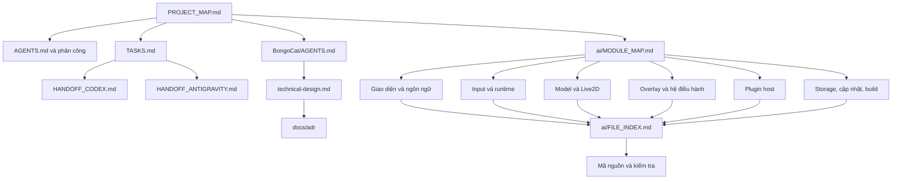

# Bản đồ dự án — bắt đầu tại đây

Cập nhật: 24/10/2026. Workspace: `Pet`; repository đang có: **BongoCat (Rust)**.
DeskBuddy Python trong hội thoại cũ hiện không có trong workspace.
Bản đồ là công cụ điều hướng, không chứng minh mọi chức năng đã chạy đúng.

**Hiểu mục tiêu và kế hoạch trước:** [Bản tổng hợp cho Codex và Gen](ai/PROJECT_MASTER_PLAN.md).
**Ràng buộc bất biến:** [Hiến pháp Leader & Ràng buộc](ai/LEADER_CONSTITUTION.md).
**Đọc lời nhắn hai bên:** [ai/SYNC.md](ai/SYNC.md).

Sơ đồ tương tác Markmap (xem offline): [Ý tưởng người bạn desktop](ai/diagrams/companion.html)
· [Kiến trúc BongoCat](ai/diagrams/architecture.html)
· [Cách hai AI cập nhật sơ đồ](ai/diagrams/README.md).

## Lộ trình đọc cho AI

1. [Quy tắc workspace](AGENTS.md) → [Phân công](AI_COLLABORATION_REPORT.md).
2. [Nhiệm vụ](TASKS.md) → [Bàn giao Codex](HANDOFF_CODEX.md) / [Bàn giao Antigravity](HANDOFF_ANTIGRAVITY.md).
3. [Quy tắc BongoCat](BongoCat/AGENTS.md) → [Thiết kế kiến trúc](BongoCat/docs/technical-design.md).
4. [Bản đồ module](ai/MODULE_MAP.md) → [Danh mục toàn bộ file](ai/FILE_INDEX.md) → mã và kiểm tra liên quan.

Chỉ đọc sâu nhánh liên quan đến nhiệm vụ sau khi đã đọc đủ quy tắc áp dụng.
Các bảng phân công Python cũ không xác lập quyền sửa các crate Rust.

## Cây tổng quan

```text
Pet/
├── PROJECT_MAP.md                 ← đầu mối điều hướng
├── AGENTS.md / GEMINI.md          ← hướng dẫn vào dự án
├── AI_COLLABORATION_REPORT.md     ← phân công, giới hạn, bàn giao
├── TASKS.md                      ← nhiệm vụ được giao
├── HANDOFF_CODEX.md               ← lịch sử Codex
├── HANDOFF_ANTIGRAVITY.md         ← lịch sử Antigravity
├── ai/
│   ├── MODULE_MAP.md              ← vai trò module và luồng dữ liệu
│   ├── FILE_INDEX.md              ← cây đầy đủ + liên kết từng file, tự sinh
│   ├── project-index.json         ← danh mục và phụ thuộc cho máy đọc, tự sinh
│   └── refresh-map.ps1            ← tái tạo danh mục từ file hiện có
└── BongoCat/
    ├── AGENTS.md                  ← quy tắc riêng repository
    ├── Cargo.toml / Cargo.lock    ← workspace, dependency và phiên bản
    ├── justfile                   ← lệnh phát triển, kiểm tra, build
    ├── crates/                    ← 23 module Rust, xem bản đồ module
    ├── shared/                    ← behavior, config schema, fixtures
    ├── resources/                 ← icon và model
    ├── vendor/                    ← SDK Cubism và thông tin nguồn/giấy phép
    ├── docs/                      ← kiến trúc, ADR, benchmark, migration
    ├── tools/                     ← validator, kiểm tra contract, công cụ SDK
    ├── spikes/                    ← thử nghiệm kỹ thuật; không mặc định là runtime sản phẩm
    ├── macos/                     ← tài nguyên tích hợp macOS
    └── .github/                   ← CI và mẫu issue
```

## Sơ đồ liên kết

Mũi tên dưới đây nghĩa là “đọc tiếp / liên quan”, không phải dependency Rust.



## Tìm đúng nhánh theo công việc

| Bạn muốn làm gì? | Đọc đầu tiên | Đọc tiếp |
|---|---|---|
| Đổi màn hình cài đặt | [UI](BongoCat/crates/bongocat-ui/src/lib.rs) | [UI protocol](BongoCat/crates/bongocat-ui-protocol/src/lib.rs), [app/settings](BongoCat/crates/bongocat-app/src/settings) |
| Sửa phản ứng bàn phím | [input](BongoCat/crates/bongocat-input/src/lib.rs) | [platform](BongoCat/crates/bongocat-platform/src/lib.rs), [runtime](BongoCat/crates/bongocat-runtime/src/lib.rs), [input semantics](BongoCat/shared/behavior/input-semantics.md) |
| Đổi chuyển động/model | [Live2D](BongoCat/crates/bongocat-live2d/src/lib.rs) | [playback](BongoCat/crates/bongocat-live2d-playback/src/lib.rs), [model store](BongoCat/crates/bongocat-model-store/src/lib.rs), [animation semantics](BongoCat/shared/behavior/animation-semantics.md) |
| Sửa cửa sổ pet/render | [overlay](BongoCat/crates/bongocat-overlay/src/lib.rs) | [render](BongoCat/crates/bongocat-render/src/lib.rs), [Live2D render](BongoCat/crates/bongocat-live2d-render/src/lib.rs) |
| Sửa plugin | [hướng dẫn đóng góp](BongoCat/CONTRIBUTING.md) | Plugin host ở repo này; SDK và plugin chính thức ở repository riêng theo AGENTS |
| Build và phát hành | [justfile](BongoCat/justfile) | [packaging](BongoCat/crates/bongocat-packaging/src/main.rs), [update signing](BongoCat/docs/update-signing-guide.md) |
| Hiểu quyết định cũ | [ADR](BongoCat/docs/adr) | [migration](BongoCat/docs/migration), mã và bằng chứng liên quan |

## Giữ bản đồ đồng bộ

Sau khi thêm/xóa/đổi tên file hoặc đổi dependency nội bộ, chạy từ thư mục Pet:

```powershell
powershell -NoProfile -ExecutionPolicy Bypass -File .\ai\refresh-map.ps1
```

Script chỉ viết lại `ai/FILE_INDEX.md` và `ai/project-index.json`; không đổi mã ứng dụng.
Danh mục loại bỏ `.git`, output build, cache và môi trường ảo. Cây thể hiện file vật lý
hiện có; không tải thêm plugin, không suy luận trạng thái hoàn thành. Mô tả trong
`MODULE_MAP.md` phải được người sửa cập nhật khi ranh giới module thay đổi.
