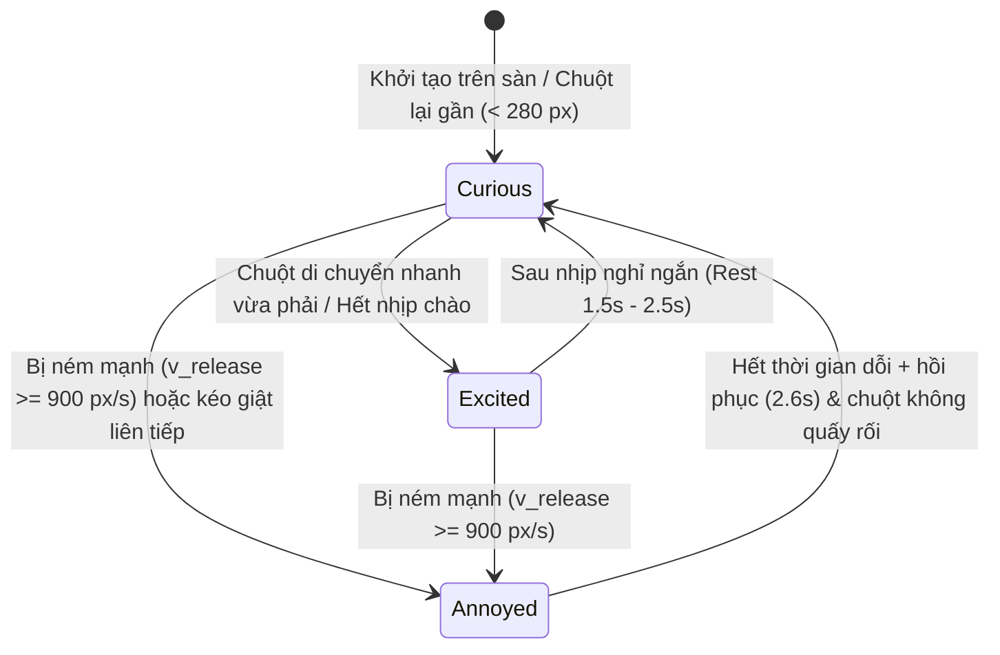

# A-03 — Đặc tả Kỹ thuật Hiệu ứng Co giãn (Squash & Stretch) & 3 Cảm xúc Người que

- **Mã bước:** `A-03`
- **Ngày lập:** 26/10/2026
- **Người thực hiện:** Gen (Chuyên gia Hình ảnh, Hoạt họa & Tư vấn Dự án Pet)
- **Trạng thái:** **HOÀN THÀNH (PASSED)** — Đã lập đầy đủ thông số toán học cho hiệu ứng co giãn (nén khi chạm đất, giãn khi rơi), đặc tả 3 cảm xúc ngắn hạn (**Tò mò**, **Phấn khích**, **Khó chịu**), hợp đồng dữ liệu Rust cho bước `C-04` / `A-04` và chạy kiểm chứng hình học không tràn biên canvas.

---

## 1. Khung Cam Kết Lượt Làm Việc & Cơ sở Đối chiếu Thực tế

### 1.1. Khung Cam kết (Theo Điều 4 `ai/LEADER_CONSTITUTION.md`)
- **Mã Ticket:** `A-03`
- **Danh sách file tạo/cập nhật:**
  - `ai/A03_EMOTION_SPEC.md` (Báo cáo & đặc tả kỹ thuật chính thức bước A-03)
  - `ai/A-03.evidence.json` (Manifest nghiệm thu SHA256 chuẩn UTF-8 không BOM)
  - `ai/logs/A03/cargo-test-baseline.log` (Log kiểm tra hợp đồng `stickman` & `physics` hiện có)
  - `ai/logs/A03/verify_a03_spec.ps1` & `ai/logs/A03/spec-verification.log` (Kịch bản & log kiểm tra toán học co giãn + máy trạng thái 3 cảm xúc + kiểm tra biên canvas)
  - `ai/logs/A03/A03-poses-preview.png` (Bảng ảnh trực quan 5 trạng thái: Nén chạm đất, Giãn khi rơi, Tò mò, Phấn khích, Khó chịu ở tỷ lệ duyệt `154 × 267 px` / người que cao `~256 px`)
  - `HANDOFF_ANTIGRAVITY.md` (Cập nhật bàn giao lượt A-03)
- **Ranh giới bảo toàn:** Giữ nguyên 100% mã nguồn `.rs` và các file trong hồ sơ `C-02`, `A-02`, `C-03`; không sửa `ai/SYNC.md`.

### 1.2. Thông số nền tảng từ `C-02`, `A-02`, `C-03` được kế thừa chính xác
1. **Không gian Model & Canvas (`BongoCat/crates/bongocat-render/src/stickman.rs`):**
   - Trục `Y` hướng lên; `CanvasInfo`: `width = 0.60`, `height = 1.04`, `origin_x = 0.30`, `origin_y = 0.52` (miền hợp lệ: $x \in [-0.30, +0.30]$, $y \in [-0.52, +0.52]$).
   - Khung xương chuẩn đứng thẳng (`standing_snapshot`):
     - Đầu rỗng: tâm `[0.0, 0.38]`, bán kính trong $r_{\text{in}} = 0.092$, bán kính ngoài $r_{\text{out}} = 0.120$ (đỉnh đầu tại $y = +0.50$).
     - Thân (Torso): `[0.0, 0.26] -> [0.0, -0.13]`, bán kính capsule $r = 0.014$.
     - Tay trái / phải: `[0.0, 0.20] -> [-0.24, -0.04]` và `[0.0, 0.20] -> [0.24, -0.04]` (biên ngang $\pm 0.254$).
     - Chân trái / phải: `[0.0, -0.13] -> [-0.17, -0.486]` và `[0.0, -0.13] -> [0.17, -0.486]` (đáy bàn chân tính cả bán kính capsule $0.014$ nằm đúng tại $y_{\text{foot}} = -0.50$).
2. **Tỷ lệ hiển thị đã duyệt (`ai/A02_VISUAL_QA_REPORT.md`):**
   - Trên màn hình tham chiếu `2560 × 1600`: cửa sổ overlay `154 × 267 px` (`scale_percent = 44%`), hộp bao hiển thị của người que đứng thẳng là **`130 × 257 px`** ($\approx 16\%$ chiều cao màn hình).
3. **Thông số vật lý thực tế (`BongoCat/crates/bongocat-runtime/src/physics.rs`):**
   - Trọng lực: $g = 1800.0\text{ px/s}^2$ (trục `Y` màn hình hướng xuống).
   - Bước chia nhỏ vật lý tối đa: $\Delta t_{\max} = 1 / 240\text{ s}$; giới hạn bù trễ `0.1 s`.
   - Giới hạn tốc độ kéo/ném tối đa: $v_{\max} = 2400.0\text{ px/s}$.
   - Ngưỡng chạm sàn tạo nảy: khi $v_y > 180.0\text{ px/s}$, vận tốc nảy lại được gán cố định $v_{y,\text{rebound}} = -\sqrt{2 \times 1800.0 \times 4.0} = -120.0\text{ px/s}$ (độ cao nảy tối đa đúng **`4.0 px`**).
   - Ma sát trượt ngang trên sàn: $v_x \leftarrow v_x \cdot e^{-10.0 \Delta t}$, triệt tiêu về `0` khi $|v_x| < 1.0\text{ px/s}$.
   - Hệ số bật tường trái/phải: $v_x \leftarrow -0.15 \cdot v_x$.

---

## 2. Thiết kế Hiệu ứng Co giãn (Squash & Stretch Specification)

### 2.1. Nguyên lý Bảo toàn Thể tích & Điểm neo Chân (`Foot Anchor`)
Để người que biến dạng sống động theo vận tốc vật lý mà **không bị lơ lửng trên không khi giãn** hoặc **xuyên xuống dưới sàn khi nén**, phép biến đổi co giãn dùng điểm neo đáy bàn chân $y_{\text{anchor}} = -0.50$ trong không gian model khi tiếp đất, và tâm khối $y_{\text{center}} = 0.0$ khi đang bay trên không:

$$x' = x \cdot S_x + \Delta x_{\text{lean}}, \qquad y' = y_{\text{pivot}} + (y - y_{\text{pivot}}) \cdot S_y$$

Trong đó:
- $S_y \in [0.78, 1.16]$ là hệ số co giãn dọc.
- $S_x = \text{clamp}\left(\frac{1}{\sqrt{S_y}},\; 0.88,\; 1.12\right)$ là hệ số co giãn ngang bảo toàn diện tích cảm nhận nhưng khóa biên ngang để mọi đỉnh $(x', y')$ luôn nằm gọn trong `CanvasInfo` ($|x'| \le 0.295 < 0.30$, $|y'| \le 0.515 < 0.52$).

### 2.2. Công thức Giãn khi Rơi & Phóng lên (`Airborne Stretch`)
Khi người que ở trên không (`!is_on_floor && !is_held`), độ giãn dọc $S_y$ tỷ lệ thuận với tốc độ dọc $|v_y|$ từ `PhysicsBody`:

1. **Khi rơi xuống ($v_y > 0$ trên hệ tọa độ màn hình):**
   - Ngưỡng bắt đầu giãn: $v_{y,\text{threshold}} = 180.0\text{ px/s}$ (khớp đúng ngưỡng gây nảy của `physics.rs`).
   - Công thức chuẩn hóa:
     $$u_{\text{fall}} = \text{clamp}\left(\frac{v_y - 180.0}{2400.0 - 180.0},\; 0.0,\; 1.0\right)$$
     $$S_y = 1.0 + 0.14 \cdot u_{\text{fall}} \quad \in [1.00,\; 1.14]$$
     $$S_x = 1.0 - 0.08 \cdot u_{\text{fall}} \quad \in [0.92,\; 1.00]$$
   - **Tư thế khớp xương đi kèm (`PoseId::Fall`):**
     - Khi $u_{\text{fall}} > 0$: hai tay vung dần lên phía trên đầu theo sức cản không khí (cổ tay dịch từ $y = -0.04$ lên $y = +0.18 + 0.16 \cdot u_{\text{fall}}$), hai chân khép nhẹ vào trong ($x_{\text{foot}}$ thu từ $\pm 0.17$ về $\pm 0.11$) để đón mặt đất.
     - Nghiêng người theo vận tốc ngang $v_x$: $\Delta x_{\text{lean}} = \text{clamp}(v_x / 2400.0,\; -1.0,\; 1.0) \times 0.03 \cdot (y + 0.50)$.

2. **Khi bật nhảy hoặc bị ném hướng lên ($v_y < -120.0\text{ px/s}$):**
   - Hệ số giãn phóng lên:
     $$u_{\text{rise}} = \text{clamp}\left(\frac{|v_y| - 120.0}{1800.0},\; 0.0,\; 1.0\right), \qquad S_y = 1.0 + 0.10 \cdot u_{\text{rise}} \in [1.00,\; 1.10], \qquad S_x = 1.0 - 0.06 \cdot u_{\text{rise}}$$

3. **Tại đỉnh quỹ đạo (`Apex`, $|v_y| \le 120.0\text{ px/s}$ trên không):**
   - Cơ thể trả về tỷ lệ tự nhiên $S_y = 1.00, S_x = 1.00$, đầu gối hơi co nhẹ ($\Delta y_{\text{foot}} = +0.03$).

### 2.3. Công thức Nén khi Chạm đất (`Landing Squash` & Phục hồi lò xo tắt dần)
Ngay tại thời điểm va chạm sàn ($y_{\text{body}} \ge \text{floor}$ khi $v_{y,\text{impact}} > 180.0\text{ px/s}$):

1. **Cường độ nén tức thời theo vận tốc chạm đất $v_{y,\text{impact}}$:**
   $$u_{\text{impact}} = \text{clamp}\left(\frac{v_{y,\text{impact}} - 180.0}{2400.0 - 180.0},\; 0.0,\; 1.0\right)$$
   $$A_{\text{squash}} = 0.08 + 0.14 \cdot u_{\text{impact}} \quad \in [0.08,\; 0.22]$$
   - Rơi nhẹ ($v_{y,\text{impact}} \approx 300\text{ px/s}$): nén nhẹ $S_{y,\min} \approx 0.91$ ($-9\%$ chiều cao).
   - Bị ném cực mạnh ($v_{y,\text{impact}} = 2400\text{ px/s}$): nén tối đa $S_{y,\min} = 1.0 - 0.22 = 0.78$ ($-22\%$ chiều cao, tương ứng hạ thấp ~56 px từ 257 px xuống 200 px), mở rộng ngang $S_{x,\max} = 1.10$ ($+10\%$).

2. **Hàm hồi phục theo thời gian sau chạm đất ($t \in [0,\; T_{\text{land}}]$ với $T_{\text{land}} = 220\text{ ms}$):**
   - Pha nén nhanh (từ $t = 0$ đến $t_{\text{peak}} = 45\text{ ms}$):
     $$S_y(t) = 1.0 - A_{\text{squash}} \cdot \sin\left(\frac{\pi}{2} \cdot \frac{t}{0.045}\right)$$
   - Pha bật hồi phục có vượt ngưỡng nhẹ (từ $t = 45\text{ ms}$ đến $220\text{ ms}$):
     $$\tau = \frac{t - 0.045}{0.175}, \qquad S_y(t) = 1.0 - A_{\text{squash}} \cdot e^{-5.5 \tau} \cdot \cos(1.5 \pi \tau)$$
   - Neo biến đổi tại mặt sàn $y_{\text{pivot}} = -0.50$: bàn chân luôn bám sát đáy vùng làm việc (hoặc đi theo độ nảy 4 px của `PhysicsBody`), không bao giờ xuyên xuống dưới taskbar.

### 2.4. Bảng Tổng hợp Thông số Co giãn theo Trạng thái Vật lý

| Pha chuyển động | Điều kiện kích hoạt (từ `PhysicsBody`) | Điểm neo $y_{\text{pivot}}$ | Hệ số dọc $S_y$ | Hệ số ngang $S_x$ | Thời lượng / Hồi phục |
|---|---|---|---|---|---|
| **Đứng/Nghỉ (`Idle`)** | Trên sàn, $|v_x| < 1\text{ px/s}, v_y = 0$ | $-0.50$ (Đáy chân) | $1.00 \pm 0.012\sin(\omega t)$ | $1.00 \mp 0.006\sin(\omega t)$ | Nhịp thở chu kỳ `1.8 s` |
| **Lấy đà nhảy (`JumpTakeoff`)** | Chuẩn bị nhảy từ sàn | $-0.50$ (Đáy chân) | `0.84` (nén $-16\%$) | `1.08` (nở $+8\%$) | `90 ms` trước khi rời sàn |
| **Phóng lên (`JumpLaunch`)** | Rời sàn với $v_y < -120\text{ px/s}$ | $0.00$ (Tâm thân) | `1.00 -> 1.10` | `1.00 -> 0.94` | Theo vận tốc dọc $|v_y|$ |
| **Đỉnh rơi (`Apex`)** | Trên không, $|v_y| \le 120\text{ px/s}$ | $0.00$ (Tâm thân) | `1.00` | `1.00` | Quá độ tự nhiên |
| **Rơi tự do (`Fall`)** | Trên không, $v_y > 180\text{ px/s}$ | $0.00$ (Tâm thân) | `1.00 -> 1.14` | `1.00 -> 0.92` | Tuyến tính theo $v_y \le 2400\text{ px/s}$ |
| **Chạm đất (`Land`)** | Vừa chạm sàn với $v_{y,\text{impact}} > 180\text{ px/s}$ | $-0.50$ (Đáy chân) | `0.78 -> 1.03 -> 1.00` | `1.10 -> 0.98 -> 1.00` | `220 ms` (đỉnh nén ở `45 ms`) |
| **Bị giữ chuột (`Held`)** | `body.is_held() == true` | $+0.38$ (Tâm đầu) | `1.04` (buông thõng) | `0.97` | Nghiêng ngược chiều kéo chuột |

---

## 3. Thiết kế 3 Cảm xúc Ngắn hạn (Tò mò, Phấn khích, Khó chịu)

Tuân thủ tuyệt đối mục 3 của `ai/PROJECT_MASTER_PLAN.md`:
- Ba cảm xúc ngắn hạn duy nhất: **Tò mò (`Curious`)**, **Phấn khích (`Excited`)**, **Khó chịu (`Annoyed`)**.
- Thứ tự ưu tiên điều khiển bất biến:
  $$\text{Paused (Tạm dừng)} > \text{Held (Đang bị giữ)} > \text{Physics (Đang rơi / nảy / trượt mạnh)} > \text{Autonomous Emotion (Cảm xúc tự chủ)} > \text{Idle (Nghỉ)}$$
- Mỗi cảm xúc và hành vi con có **thời gian duy trì tối thiểu (`min_duration`)** và **thời gian nghỉ (`cooldown`)** để chống đổi trạng thái liên tục theo từng frame.



### 3.1. Cảm xúc 1: TÒ MÒ (`Emotion::Curious`)
- **Ý nghĩa trải nghiệm:** Người que chú ý tới con trỏ chuột của người dùng, nghiêng đầu quan sát, rón rén bước lại gần để tìm hiểu và vẫy tay chào thân thiện khi được click nhẹ.
- **Điều kiện kích hoạt (`Trigger`):**
  1. Con trỏ chuột đi vào bán kính chú ý $d_{\text{cursor}} \le 280\text{ px}$ tính từ tâm người que với tốc độ vừa phải ($v_{\text{cursor}} < 900\text{ px/s}$), **hoặc**
  2. Người dùng **click chuột trái ngắn** (nhấn và thả trong $< 180\text{ ms}$, quãng đường di chuyển $< 6\text{ px}$, phân biệt rõ với thao tác kéo `drag`), **hoặc**
  3. Trạng thái mặc định sau khi vừa hồi phục từ `Annoyed` / `Idle`.
- **Hành vi & Vận tốc (`Behavior`):**
  - Hướng mặt (`facing_right`): luôn quay về phía tọa độ `X` của con trỏ chuột (có vùng trễ `deadzone = 12 px` để không lật mặt liên tục khi chuột ở ngay trên đầu).
  - Nếu $90\text{ px} < |x_{\text{cursor}} - x_{\text{center}}| \le 280\text{ px}$: đi bộ thong thả (`Walk`) về phía hình chiếu ngang của con trỏ với tốc độ $v_x = \pm 110.0\text{ px/s}$.
  - Nếu $|x_{\text{cursor}} - x_{\text{center}}| \le 90\text{ px}$: dừng lại, nghiêng đầu và thân trên một góc $10^\circ$ về phía con trỏ (`CuriousTilt`).
  - Nếu nhận sự kiện **Click ngắn**: chuyển sang động tác vẫy tay chào (`WaveHello`) trong `1.20 s` (3 nhịp vẫy ở tần số `2.5 Hz`).
- **Thông số Khung xương (`Skeleton Pose` — Không gian Model):**
  - Tâm đầu nghiêng về hướng nhìn: `[+0.045, 0.375]` (khi nhìn phải), bán kính giữ nguyên `0.092..0.120`.
  - Vai và thân hơi rướn tới trước: cổ ở `[+0.025, 0.26]`, hông ở `[0.0, -0.13]`.
  - Khi vẫy chào (`WaveHello`): tay phải giơ cao lên góc trên `[0.0, 0.20] -> [+0.21, +0.34 + 0.05 * sin(2π * 2.5 * t)]`, tay trái chống hông nhẹ `[-0.14, -0.02]`.
- **Thời lượng & Cooldown:**
  - `min_duration`: `2.0 s` cho trạng thái cảm xúc `Curious`; động tác `WaveHello` khóa tối thiểu `1.2 s`.
  - `cooldown`: `1.5 s` giữa hai lần vẫy chào liên tiếp.

### 3.2. Cảm xúc 2: PHẤN KHÍCH (`Emotion::Excited`)
- **Ý nghĩa trải nghiệm:** Thể hiện bản chất rất hiếu động có chủ đích của người que: chạy nước rút đuổi theo con trỏ, bật nhảy vui vẻ, leo dọc hai mép màn hình khi chạm cạnh, và có nhịp nghỉ ngắn xen kẽ để không gây rối mắt.
- **Điều kiện kích hoạt (`Trigger`):**
  1. Đang ở `Curious` mà con trỏ chuột di chuyển ngang qua lại trong bán kính $d_{\text{cursor}} \le 360\text{ px}$ với tốc độ $250\text{ px/s} \le v_{\text{cursor}} \le 1400\text{ px/s}$ (rủ chơi đuổi bắt), **hoặc**
  2. Tự phát theo chu kỳ hiếu động sau `6.0 s` đứng yên/đi bộ trên sàn mà không bị người dùng giữ.
- **Chuỗi hành vi có nhịp nghỉ (`Action Sub-states`):**
  1. **Chạy đuổi chuột / Chạy nước rút (`ExcitedRun`):**
     - Tốc độ ngang: $v_x = \pm 280.0\text{ px/s}$ (gấp ~2.5 lần đi bộ), chu kỳ bước chạy `0.38 s/vòng` (4 thế Alan Becker: Contact, Down, Passing, Up/Airtime).
     - Thân người đổ về phía trước góc $18^\circ$ ($\Delta x_{\text{head}} = +0.065$, $\Delta x_{\text{neck}} = +0.040$).
  2. **Nhảy vui / Bắt chuột trên cao (`ExcitedJump`):**
     - Khi con trỏ ở phía trên người que ($y_{\text{cursor}} < y_{\text{top}} - 40\text{ px}$ và $|\Delta x| < 140\text{ px}$): lấy đà nén `90 ms` ($S_y = 0.84$) rồi phóng lên với vận tốc $v_{y,0} = -620.0\text{ px/s}$ (độ cao nhảy $\Delta h = v_{y,0}^2 / (2g) \approx 106.8\text{ px}$).
  3. **Leo cạnh màn hình (`ClimbWall`):**
     - Khi chạy chạm mép trái (`x <= area.left`) hoặc mép phải (`x >= area.right - size.x`): bám mép và leo lên với tốc độ dọc $v_{y,\text{climb}} = -160.0\text{ px/s}$, tay và chân vươn so le đường chéo chu kỳ `0.45 s`. Khi lên tới đỉnh (`y <= area.top + 20 px`) hoặc hết `3.0 s` leo: dừng `0.35 s` nhìn xuống rồi búng nhẹ rời tường ($v_x = \mp 140\text{ px/s}$) để rơi tự do về sàn.
  4. **Nhịp nghỉ ngắn bắt buộc (`ShortRest`):**
     - Sau mỗi đợt chạy/nhảy/leo kéo dài `3.2 s – 4.5 s`, người que **bắt buộc đứng nghỉ thở nhịp nhàng trong `1.5 s – 2.2 s`** trước khi chọn hành vi tiếp theo.
- **Thông số Khung xương (`Skeleton Pose` — Đỉnh phấn khích / Cheer):**
  - Tâm đầu nâng cao `[+0.03, 0.40]`; hai tay vung năng động hoặc giơ chữ V (`[-0.22, +0.26]` và `[+0.22, +0.26]`); hai chân sải rộng `[-0.21, -0.47]` và `[+0.21, -0.47]`.
- **Thời lượng & Cooldown:**
  - `min_duration` mỗi hành vi con: `Run >= 1.2 s`, `Jump >= 0.7 s`, `Climb >= 1.0 s`, `ShortRest >= 1.5 s`.
  - `cooldown` giữa 2 cú nhảy liên tiếp: `1.8 s`; giữa 2 lần leo tường: `4.0 s`.

### 3.3. Cảm xúc 3: KHÓ CHỊU (`Emotion::Annoyed`)
- **Ý nghĩa trải nghiệm:** Phản ứng có cá tính sau khi bị người dùng ném mạnh xuống sàn/vào tường hoặc bị con trỏ lao vào quá gắt: người que ngồi thụp/khoanh tay giận dỗi hoặc né tránh con trỏ chuột, sau đó tự thở dài phủi bụi và hồi phục về trạng thái thân thiện.
- **Điều kiện kích hoạt (`Trigger`):**
  1. **Sau khi bị ném mạnh:** Lúc thả chuột (`Release`), tốc độ ném $v_{\text{throw}} = \sqrt{v_x^2 + v_y^2} \ge 900.0\text{ px/s}$ (trên thang tối đa $2400.0\text{ px/s}$ của `physics.rs`), kích hoạt ngay khi người que chạm sàn dừng lại, **hoặc**
  2. **Bị nhấc-thả liên tục:** Bị `grab` $\ge 3$ lần trong vòng `4.0 s`, **hoặc**
  3. **Chuột lao vào đột ngột:** Con trỏ lao thẳng vào người que với $v_{\text{cursor}} > 1600\text{ px/s}$ ở khoảng cách $< 120\text{ px}$ (kích hoạt `Surprise` `0.30 s` rồi chuyển sang `Annoyed`).
- **Chuỗi hành vi 3 pha (`Sulk -> Evade -> Recover`):**
  1. **Pha 1 — Giận dỗi (`Sulk`, `0.0 s -> 1.6 s`):**
     - Ngồi thụp/hạ thấp trọng tâm ($S_y = 0.86$), **quay lưng lại phía con trỏ chuột**, hai tay khoanh trước ngực, đầu hơi cúi.
     - Màu sắc thân (`multiply_color` trong `DrawableSnapshot`): chuyển nhẹ từ đen thuần `[0.0, 0.0, 0.0, 1.0]` sang tông đỏ sậm ấm `[0.35, 0.05, 0.05, 1.0]` để biểu thị sự quạu mà không cần bong bóng lời thoại.
  2. **Pha 2 — Né chuột (`Evade`, nếu chuột tiến lại gần $< 180\text{ px}$ trong lúc đang khó chịu):**
     - Thay vì tiến lại gần như `Curious`, người que **bước lùi hoặc chạy né sang hướng ngược lại** với vận tốc $v_{x,\text{evade}} = -220.0\text{ px/s} \times \text{sign}(x_{\text{cursor}} - x_{\text{center}})$ trong `0.6 s` để giữ khoảng cách với con trỏ.
  3. **Pha 3 — Hồi phục (`Recover`, `1.6 s -> 2.6 s`):**
     - Hít sâu nâng vai ($S_y = 1.03$ trong `0.3 s` rồi về `1.00`), đứng thẳng dậy, lắc nhẹ hai tay phủi bụi, `multiply_color` trả về `[0.0, 0.0, 0.0, 1.0]` và chuyển mượt về `Emotion::Curious` / `Idle`.
- **Thông số Khung xương (`Skeleton Pose` — `Sulk`):**
  - Hạ thấp hông và cổ (`y_{\text{pivot}} = -0.50`, $S_y = 0.86$): tâm đầu ở `[-0.03, 0.31]`, cổ `[0.0, 0.20]`, hông `[0.0, -0.18]`.
  - Hai tay khoanh gọn trước ngực: vai trái `[0.0, 0.16] -> [+0.11, 0.05]`, vai phải `[0.0, 0.16] -> [-0.11, 0.05]`.
  - Hai chân khuỵu vững trên sàn: `[0.0, -0.18] -> [-0.16, -0.486]` và `[0.0, -0.18] -> [+0.16, -0.486]`.
- **Thời lượng & Cooldown:**
  - `min_duration`: `2.6 s` (gồm `1.6 s` dỗi/né + `1.0 s` hồi phục) — trừ khi người dùng chủ động nhấc lên lần nữa (ưu tiên `Held`).
  - `cooldown`: Sau khi `Recover` hoàn tất, miễn nhiễm kích hoạt `Annoyed` do tốc độ chuột trong `2.0 s` để tránh kẹt ở trạng thái quạu.

### 3.4. Bảng Tổng hợp Thông số 3 Cảm xúc & Chuyển tiếp

| Cảm xúc | Kích hoạt chính (`Trigger`) | Hành vi chủ đạo | Vận tốc ngang $v_x$ | Tỷ lệ $(S_x, S_y)$ | Thời lượng tối thiểu | Cooldown lặp | Màu sắc (`multiply_color`) |
|---|---|---|---|---|---|---|---|
| **Tò mò (`Curious`)** | Chuột ở gần $\le 280\text{ px}$ ($v_{\text{cursor}} < 900\text{ px/s}$) hoặc Click ngắn $< 180\text{ ms}$ | Nghiêng đầu nhìn chuột, đi bộ lại gần, vẫy tay chào (`WaveHello`) | $\pm 110\text{ px/s}$ (đi bộ) hoặc $0$ (đứng vẫy) | $(1.00,\; 1.00)$ | `2.0 s` (`Wave`: `1.2 s`) | `1.5 s` (vẫy tay) | `[0.0, 0.0, 0.0, 1.0]` |
| **Phấn khích (`Excited`)** | Chuộtเคลื่อน động $250..1400\text{ px/s}$ trong $\le 360\text{ px}$ hoặc sau `6.0 s` nghỉ | Chạy đuổi chuột (`Run`), bật nhảy (`Jump`), leo cạnh (`Climb`), xen kẽ `ShortRest` | $\pm 280\text{ px/s}$ (chạy); $v_{y,0} = -620\text{ px/s}$ (nhảy) | Theo pha chạy/nhảy $[0.84..1.10]$ | `1.2 s` / động tác + `1.5 s` nghỉ | Nhảy: `1.8 s`; Leo: `4.0 s` | `[0.0, 0.0, 0.0, 1.0]` |
| **Khó chịu (`Annoyed`)** | Bị ném mạnh $v_{\text{throw}} \ge 900\text{ px/s}$, kéo $\ge 3$ lần/`4 s`, hoặc chuột lao $> 1600\text{ px/s}$ | Khoanh tay giận dỗi (`Sulk`), chạy né chuột (`Evade`), thở dài hồi phục (`Recover`) | $0$ (dỗi) hoặc $\pm 220\text{ px/s}$ (chạy né chuột) | Dỗi: $(1.05,\; 0.86)$ $\rightarrow$ Hồi phục: $(1.00,\; 1.00)$ | `2.6 s` (`1.6 s` dỗi + `1.0 s` hồi phục) | `2.0 s` sau hồi phục | Dỗi: `[0.35, 0.05, 0.05, 1.0]` $\rightarrow$ Đen |

---

## 4. Hợp đồng Kiểu dữ liệu Rust Đề xuất cho Bước `C-04` & `A-04`

Thiết kế dưới đây tuân thủ nghiêm ngặt kiến trúc của `BongoCat` (`AGENTS.md` mục 4.2 & 4.3):
- Đặt máy trạng thái cảm xúc tại `crates/bongocat-runtime` (dùng thời gian đơn điệu `Duration` truyền vào, không chứa `HWND` hay tài nguyên GPU).
- Đặt hàm dựng mesh biến dạng và tư thế tại `crates/bongocat-render/src/stickman.rs` (chỉ nhận struct thông số bất biến và trả về `RenderSnapshot`).

```rust
/// Ba cảm xúc ngắn hạn đã được duyệt trong PROJECT_MASTER_PLAN.md.
#[derive(Clone, Copy, Debug, Default, PartialEq, Eq)]
pub enum CompanionEmotion {
    #[default]
    Curious,
    Excited,
    Annoyed,
}

/// Các tư thế hiển thị của người que để truyền từ runtime sang renderer.
#[derive(Clone, Copy, Debug, Default, PartialEq, Eq)]
pub enum StickmanPoseId {
    #[default]
    Idle,
    CuriousTilt,
    WaveHello,
    Walk,
    ExcitedRun,
    JumpTakeoff,
    AirborneFall,
    LandSquash,
    ClimbWall,
    HeldByPointer,
    Surprise,
    AnnoyedSulk,
    AnnoyedEvade,
    Recover,
}

/// Snapshot tư thế và biến dạng co giãn truyền sang bongocat-render.
#[derive(Clone, Copy, Debug, PartialEq)]
pub struct StickmanPoseState {
    pub emotion: CompanionEmotion,
    pub pose: StickmanPoseId,
    pub facing_right: bool,
    /// Tiến độ chu kỳ động tác trong đoạn [0.0, 1.0].
    pub phase: f32,
    /// Hệ số co giãn ngang trong đoạn [0.88, 1.12].
    pub scale_x: f32,
    /// Hệ số co giãn dọc trong đoạn [0.78, 1.16].
    pub scale_y: f32,
    /// Độ nghiêng thân theo vận tốc hoặc hướng nhìn trong đoạn [-0.05, 0.05].
    pub lean_x: f32,
    /// Màu nhân (multiply_color) cho phép ửng đỏ nhẹ khi AnnoyedSulk.
    pub tint_rgba: [f32; 4],
}
```

---

## 5. Kiểm tra Thực tế Đã Chạy & Bằng chứng trên Ổ cứng

1. **Kiểm tra hợp đồng nền tảng `stickman` (`bongocat-render`) & `physics` (`bongocat-runtime`):**
   - Lệnh: `cargo test --manifest-path BongoCat/Cargo.toml --locked -p bongocat-render -p bongocat-runtime`
   - Kết quả: **`exit 0`** (22 passed trong `bongocat-render`, 121 unit tests + 2 fixture tests passed trong `bongocat-runtime`), lưu log tại `ai/logs/A03/cargo-test-baseline.log`.
2. **Kiểm tra toán học Co giãn, Biên Canvas (`0.60 × 1.04`) & Kết xuất Bảng Minh họa 5 Trạng thái (`A-03`):**
   - Lệnh: `powershell -NoProfile -ExecutionPolicy Bypass -File ai/logs/A03/verify_a03_spec.ps1`
   - Kết quả: **`exit 0`** (Log lưu tại `ai/logs/A03/spec-verification.log`):
     - Kiểm tra **Nén tối đa khi chạm đất** ($v_{y,\text{impact}} = 2400\text{ px/s} \Rightarrow S_y = 0.78, S_x = 1.10$, neo chân $y_{\text{pivot}} = -0.50$): toàn bộ đỉnh nằm trong $x \in [-0.2794, +0.2794] \subset [-0.30, +0.30]$, $y \in [-0.5000, +0.2800] \subset [-0.52, +0.52]$, đáy chân cố định tại $y = -0.5000$ (sai số xuyên sàn `0.0 px`).
     - Kiểm tra **Giãn tối đa khi rơi** ($v_y = 2400\text{ px/s} \Rightarrow S_y = 1.14, S_x = 0.92$, neo tâm $y_{\text{pivot}} = 0.00$): toàn bộ đỉnh nằm trong $x \in [-0.2337, +0.2337] \subset [-0.30, +0.30]$, $y \in [-0.5130, +0.5130] \subset [-0.52, +0.52]$, không tràn biên `CanvasInfo`.
     - Kiểm tra **3 cảm xúc (`Curious`, `Excited`, `Annoyed`)**: toàn bộ toạ độ khớp và hộp bao hiển thị đạt chuẩn trong khung `154 × 267 px` (`scale_percent = 44%`).
     - Xuất bảng ảnh trực quan 5 trạng thái (`Land Squash`, `Fall Stretch`, `Curious`, `Excited`, `Annoyed`) tại `ai/logs/A03/A03-poses-preview.png` (`770 × 267 px`, gồm 5 ô `154 × 267 px`).

---

## 6. Giới hạn Trung thực & Bàn giao Bước Tiếp theo (`C-04`)

- **Hiện trạng thực tế:** Bước `A-03` là bước thiết kế đặc tả kỹ thuật và kiểm chứng mô hình toán học/hình học của Gen. Các công thức co giãn và máy trạng thái 3 cảm xúc trong tài liệu này **chưa được ghép vào vòng lặp runtime mặc định của `bongocat-app`**.
- **Bảo toàn phạm vi:** Gen không sửa bất kỳ file `.rs` nào của Codex và không sửa `ai/SYNC.md`. Toàn bộ SHA256 của các bước `C-02`, `A-02`, `C-03` được giữ nguyên vẹn 100%.
- **Bàn giao cho Codex ở bước `C-04` (Lập trình Trí tuệ, Hành vi & Menu điều khiển):**
  1. Triển khai máy trạng thái hành vi sử dụng đúng thứ tự ưu tiên `Paused > Held > Physics > Emotion (Curious / Excited / Annoyed) > Idle` cùng các ngưỡng vận tốc/khoảng cách và `min_duration`/`cooldown` đã định nghĩa ở Mục 3.
  2. Tích hợp menu điều khiển (`Tạm dừng / Tiếp tục`, `Đưa về vị trí an toàn`, `Thoát`) và xuất `StickmanPoseState` để bước `A-04` hoàn thiện hoạt ảnh các tư thế trong `bongocat-render`.
