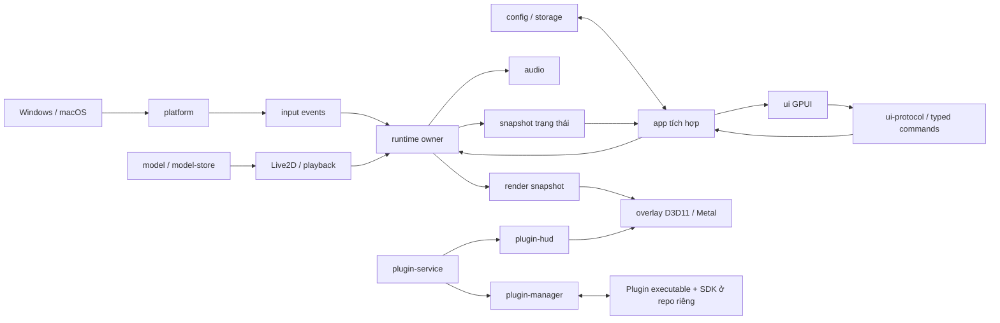

# Bản đồ module BongoCat

[← Trang đầu](../PROJECT_MAP.md) · [Toàn bộ file](FILE_INDEX.md) · [Dữ liệu máy đọc](project-index.json)

Nguồn: các `Cargo.toml`, cây `src/`, [thiết kế](../BongoCat/docs/technical-design.md)
và [quy tắc repository](../BongoCat/AGENTS.md), đọc ngày 24/10/2026.
Mô tả dưới đây là bản đồ trách nhiệm tổng quan, không phải xác minh từng hành vi.

## 23 crate và trách nhiệm

Mỗi đường dẫn đưa đến module thật. Từ `lib.rs` đọc các khai báo `mod` để đi sâu.

| Nhánh | Module / điểm vào | Vai trò |
|---|---|---|
| Lắp ghép | [app](../BongoCat/crates/bongocat-app/src/main.rs) | Entry point; application lifecycle, settings, menu, shutdown và kết nối các dịch vụ |
| Giao diện | [ui](../BongoCat/crates/bongocat-ui/src/lib.rs) | Cửa sổ cài đặt GPUI; window, update window, component |
| Giao diện | [ui-protocol](../BongoCat/crates/bongocat-ui-protocol/src/lib.rs) | Hợp đồng kiểu dữ liệu settings/update giữa giao diện và ứng dụng |
| Giao diện | [i18n](../BongoCat/crates/bongocat-i18n/src/lib.rs) | Ngôn ngữ và bản dịch |
| Input | [input](../BongoCat/crates/bongocat-input/src/lib.rs) | Kiểu input/cursor/gamepad chung |
| Logic | [runtime](../BongoCat/crates/bongocat-runtime/src/lib.rs) | Owner trạng thái, worker, input state, hoạt động, pacing và render projection |
| Hệ điều hành | [platform](../BongoCat/crates/bongocat-platform/src/lib.rs) | Adapter Windows/macOS, input, shortcut, permission, menu, startup |
| Cửa sổ pet | [overlay](../BongoCat/crates/bongocat-overlay/src/lib.rs) | Cửa sổ native, vòng frame, vị trí/kích thước, backend Windows/macOS |
| Render | [render](../BongoCat/crates/bongocat-render/src/lib.rs) | Snapshot, channel, geometry và hợp đồng tài nguyên render |
| Model | [model](../BongoCat/crates/bongocat-model/src/lib.rs) | Kiểu model, package, schema và validation |
| Model | [model-store](../BongoCat/crates/bongocat-model-store/src/lib.rs) | Store model, Mver, cover và fixture contract |
| Live2D | [live2d](../BongoCat/crates/bongocat-live2d/src/lib.rs) | Load, Core wrapper, tham số, physics và vòng đời model |
| Live2D | [live2d-playback](../BongoCat/crates/bongocat-live2d-playback/src/lib.rs) | Motion và expression |
| Live2D | [live2d-render](../BongoCat/crates/bongocat-live2d-render/src/lib.rs) | Hợp đồng render Live2D |
| Âm thanh | [audio](../BongoCat/crates/bongocat-audio/src/lib.rs) | Service/worker, trạng thái và backend âm thanh |
| Dữ liệu | [config](../BongoCat/crates/bongocat-config/src/lib.rs) | Schema, validation, atomic store và window state |
| Dữ liệu | [storage](../BongoCat/crates/bongocat-storage/src/lib.rs) | Tiện ích lưu trữ chung |
| Chẩn đoán | [log](../BongoCat/crates/bongocat-log/src/lib.rs) | Log, sanitize, rotation và retention |
| Plugin | [plugin-manager](../BongoCat/crates/bongocat-plugin-manager/src/lib.rs) | Catalog, cài đặt, registry, loader và nguồn package |
| Plugin | [plugin-service](../BongoCat/crates/bongocat-plugin-service/src/lib.rs) | Owner dịch vụ plugin trong ứng dụng, command và lifecycle |
| Plugin | [plugin-hud](../BongoCat/crates/bongocat-plugin-hud/src/lib.rs) | Layout, paint và layer hiển thị plugin |
| Phân phối | [update](../BongoCat/crates/bongocat-update/src/lib.rs) | Release, runtime cập nhật và diagnostics |
| Phân phối | [packaging](../BongoCat/crates/bongocat-packaging/src/main.rs) | Entry point build/package; gọi qua justfile |

## Luồng dữ liệu khái quát

Mũi tên là luồng/trao đổi về mặt kiến trúc, không phải biểu đồ import hay thứ tự thread.

GPUI hiển thị cài đặt; pet render qua overlay riêng. Runtime giữ trạng thái nghiệp vụ;
renderer tiêu thụ snapshot. Không đưa pressed state, model Cubism hoặc GPU resource vào
state giao diện. Chi tiết chính thức xem thiết kế và ADR, không suy API từ sơ đồ này.

## Tài liệu liên kết với mã

| Nguồn | Dùng khi nào | Liên quan |
|---|---|---|
| [Technical design](../BongoCat/docs/technical-design.md) | Hiểu kiến trúc mục tiêu | Tất cả crate |
| [Product runtime](../BongoCat/docs/product-runtime.md) | Hiểu runtime sản phẩm | app, runtime, overlay |
| [ADR](../BongoCat/docs/adr) | Lý do, ranh giới, điều kiện nghiệm thu | Chọn ADR theo nhiệm vụ |
| [Input semantics](../BongoCat/shared/behavior/input-semantics.md) | Sửa input và release/reset | input, platform, runtime |
| [Animation semantics](../BongoCat/shared/behavior/animation-semantics.md) | Sửa motion và trạng thái | runtime, playback, Live2D |
| [Config contract](../BongoCat/shared/config/contract.md) | Sửa định dạng dữ liệu | config, schema và fixture |
| [Fixtures](../BongoCat/shared/fixtures/README.md) | Kiểm tra model và hành vi | model, Live2D, runtime |
| [Cubism docs](../BongoCat/docs/cubism) | Sửa SDK/FFI/model | vendor, live2d, render |
| [Benchmark](../BongoCat/docs/benchmark/README.md) | Đánh giá hiệu năng | runtime, overlay, platform |
| [Migration](../BongoCat/docs/migration) | Tra cứu lịch sử | Không tự nối lại kiến trúc cũ |
| [Tools](../BongoCat/tools) / [justfile](../BongoCat/justfile) | Xác định lệnh kiểm tra/build | Validator, contract test, CI |

## Quyền phụ trách khi làm việc

Codex dự kiến phụ trách runtime/input/platform/config/storage/update/packaging và tích hợp.
Antigravity dự kiến phụ trách giao diện, nội dung hình ảnh và asset. Đây là định hướng:
**trước khi sửa phải ghi rõ file được giao trong TASKS**, đặc biệt app/settings, overlay,
Live2D và plugin-hud có cả hiển thị lẫn logic hệ thống. Không coi toàn bộ crate có chữ
“render” là quyền sửa tự động của bên giao diện. Không sửa vendor hoặc resource bản quyền
chỉ để đổi phong cách. Plugin chính thức và SDK ở repo riêng theo hướng dẫn BongoCat.

## Dependency chính xác ở đâu?

[project-index.json](project-index.json) chứa quan hệ nội bộ trích từ các bảng
dependencies/dev-dependencies/build-dependencies trong manifest, giữ tên section.
Đó là quan hệ **khai báo**, chưa resolve feature/target và không phải call graph.
Manifest là nguồn chính xác nếu bản đồ chưa được tái sinh. Không dùng `cargo metadata`
hay build chỉ để đọc bản đồ; script không tải dependency.
