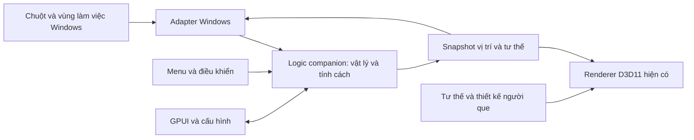

# DESKTOP COMPANION — BẢN TỔNG HỢP CHÍNH CHO CODEX VÀ GEN

> Hiện hành29/10/2026 R07: Codex tự làm/khôngsubagent. Contextualrest thayidleforced, actualpostureenergy, return/greet vàcare50-30-5 cócode/kiểmđịnh; P1nativepreview, release4800A871... mở. P2greet/carevàartR04..06chờR08/Gen, chưanghiệmthutoànđợt/R09/30phút/S4-06. [Báo cáo mới nhất](SENKO_RP_R07_PROGRESS.md); các mốc dưới đây là lịch sử.

> Hiện hành29/10/2026 R06: Codex tự làm, khôngsubagent. Gom window/foreground và SMTCPlaying/Paused/Unknown đã nối/kiểmđịnh; bỏquietbiasWork/Media, releaseD6BED9C0... mở. Art/visualR04..06 cònmở; tiếpR07, giữS4-06/phầnmới. [Báo cáo mới nhất](SENKO_RP_R06_PROGRESS.md); các mốc bên dưới là lịch sử.

> Hiện hành29/10/2026 R05: Leader yêu cầu không dùng subagent, Codex tự làm cho đến khi có chỉ đạo khác. Lõi cảm xúc bế/thả theo contact đã kiểm định; release60F5C853... mở. R04/R05 art và nghiệmthu trựcquan còn mở, khôngmởS4-06/phầnmới. [Báo cáo mới nhất](SENKO_RP_R05_PROGRESS.md); các mốc dưới đây là lịch sử.

> Hiện hành29/10/2026 R04-B: Headpat4phase và thưởng theo actualpresentedID đã kiểmđịnh; release06FA679F... mở. Luna/Max code, Codex review/finalchecks. Còn art/visualacceptance R04, khôngmởS4-06/phầnmới. [Báo cáo mới nhất](SENKO_RP_R04_B_PROGRESS.md); các mốc dưới đây là lịch sử.

> Hiện hành29/10/2026 R-04: Luna/Max codepolicy và runner, Codex review/kiểmđịnh. Moodheadtail/anti-repeat/quiet có mã; releaseD2C3A115... mở. R04 art và Headpat4phasehandover chưa hoàn tất. Xem [báo cáo mới nhất](SENKO_RP_R04_PROGRESS.md); các mốc bên dưới là lịch sử.

> Trạng thái hiện hành29/10/2026 R-03: invite/notice/fixedoffer/farewell đã nối, Look P1 chạy qua episode và actualrenderedID. Release78093347... đang mở; Play/farewell art và QA tay còn chờ. Tiếp R-04, giữ S4-06/phần mới. Xem [báo cáo mới nhất](SENKO_RP_R03_PROGRESS.md); các mốc bên dưới là lịch sử.

> Trạng thái mới nhất29/10/2026 R-02: emotion core và episode lifecycle có mã/kiểm định; live emotion observer đã nối, episode actor và biểu cảm mới chưa hiển thị. ReleaseCD59AA1E... đang mở; tiếp R-03/R-04 theo đặc tả SENKO-RP, giữ S4-06. Xem [báo cáo hiện hành](SENKO_RP_R02_PROGRESS.md). Các mốc dưới đây là lịch sử.

> Trạng thái hiện hành29/10/2026 P-04-C: lõi gia tốc leo, đà traversal và clip theo selftravel đã nối/kiểm định; release6BFDB5BD... đang mở. Visual/contact/hardware/soak còn chờ nghiệm thu. Tiếp R-02 cảm xúc trong cùng đợt nâng cấp, giữ S4-06/phần mới. Xem [báo cáo mới nhất](SENKO_RP_P04_C_PROGRESS.md). Các mốc bên dưới là lịch sử.

> Cập nhật mới nhất29/10/2026 P-04-B: moving-wall catch, mantle có giới hạn lực/clip theo body và landing recovery đã có mã/kiểm định; releaseF97E98E6... đang mở. Chưa đóng nghiệm thu P04 hoặc mở phần mới. Xem [báo cáo hiện tại](SENKO_RP_P04_B_PROGRESS.md); các mốc cũ dưới đây là lịch sử.

> Cập nhật29/10/2026 P-04-A: signedmotor phanh trước quay/cử chỉ, activevelocity khi mất sàn, relativeimpact và moving-ledge launch đã nối; runtime231+2fixture/render30/session16/Clippy/build/smoke đạt. ReleaseA45682B8... đang mở. Chưa đóng toàn P-04 hoặc R-02..R-09; xem [báo cáo mới](SENKO_RP_P04_PROGRESS.md). Quyết định SENKO-RP bên dưới tiếp tục là đặc tả hiện hành.

> Quyết định hiện hành 28/10/2026: Leader duyệt [nâng cấp phản ứng và vật lý có sức nặng](SENKO_REACTION_PHYSICS_PLAN.md), thay quy tắc quiet-app và idle cố định trước đây. Đang thực hiện R-01/P-01..P-04; có nguyên mẫu vật lý và kiểm định, chưa hoàn tất hoặc thay release. R-02..R-09 còn lại; giữ S4-06/phần mới. Xem [báo cáo nguyên mẫu](SENKO_RP_PHYSICS_PROGRESS.md). Các cập nhật cũ bên dưới là lịch sử, không thay đặc tả mới.

> Cập nhật28/10/2026 S4-04: P1 headpat đã nối; TailStroke/HeadOverwhelmed có logic, P2 tail_fluff/flustered chờ GĐ5. Region233frame,46tailcore bảo thủ, touch7/runtime215+2fixture/render30/overlay128pass22ignored/session15/Clippy/fmt/build/smoke5s đạt. Release9343463A... mởPID44380/Responding. TiếpS4-05 app/idle/chăm sóc. Giữ giới hạn QA tay/hardware trước, không suy30phút hash cũ sang bản mới. Xemai/SENKO_S4_04_TOUCH.md. Các trạng thái cũ bên dưới là lịch sử.

Ngày tổng hợp: 24/10/2026. Gen = Gemini / Antigravity trong dự án này.
Trạng thái hiện tại: **đang triển khai GĐ4; S4-01..S4-04 đã có mã và kiểm định trong phạm vi, P1 headpat đã mở, Tail/P2 chờ ảnh GĐ5; tiếp theo S4-05**. Phần QA tay/hardware GĐ3 còn được theo dõi riêng.
Tài liệu tổng hợp các quyết định người dùng đã chốt trong chat; không phải báo cáo
rằng những tính năng dưới đây đã được triển khai.

**Luật của leader:** Chỉ triển khai đúng chức năng/hành vi đã duyệt. Không tự ý
thêm/bớt/sửa chức năng; mọi nhu cầu/đề xuất hay phát hiện thay đổi ngoài duyệt phải
báo leader ngay trong chat, ghi SYNC và dừng phần đó chờ leader cho phép. Đồng thuận
giữa Codex và Gen không thay cho leader duyệt. Xem [quy ước team](TEAM_PROTOCOL.md).

## 1. Đọc nhanh: chúng ta đang làm gì?

Chúng ta lấy mã nguồn mở **BongoCat** làm nền để phát triển một **người bạn người
que sống trên desktop Windows**. Nhân vật rất hiếu động, có tính cách, chạy/nhảy/leo,
chịu trọng lực và quán tính, có thể bị người dùng nhấc lên rồi ném. Nhân vật chơi
với con trỏ và thể hiện tình cảm bằng cử chỉ.

**Không lấy hành vi gõ phím của người dùng làm trải nghiệm trung tâm.** Người que là
một người bạn độc lập, không phải hình mô phỏng người đang dùng máy tính.

- Nền công nghệ: Rust BongoCat; giữ GPUI cho cài đặt, overlay native và D3D11 cho Windows.
- Bản đầu: một người que, một màn hình chính, vật lý hoạt hình, cử chỉ không lời.
- Đồ họa mặc định: người que nguyên bản từ hình học đơn giản, chuyển tư thế theo bộ xương.
- Vận hành: cục bộ; bản thử không cần dịch vụ AI trực tuyến, tài khoản hay API trả phí.
- Chiến lược: hoàn thiện cảm giác chơi và tính cách trước, thương mại hóa để sau.

Tên thương mại cuối cùng chưa chốt. DeskBuddy/DeadlinePet là tên ý tưởng cũ;
BongoCat là nền mã nguồn. Không tự đổi brand, bundle ID hoặc nơi lưu dữ liệu lúc này.

## 2. Những quyết định đã chốt — không hỏi lại từ đầu

| Chủ đề | Quyết định của người dùng |
|---|---|
| Hướng phát triển | Nâng cấp mã Rust BongoCat, không quay lại Python Hybrid |
| Nền tảng bản đầu | Windows để người dùng thử trước |
| Nhân vật | Người que ngay, không dùng mèo làm nhân vật bản thử |
| Tính cách | Rất hiếu động; có chủ đích, không chỉ chạy ngẫu nhiên |
| Giao tiếp | Cử chỉ và hành động; chưa hội thoại AI hoặc bong bóng lời thoại |
| Vật lý | Trọng lực, quán tính, kéo–ném, nảy nhẹ; chưa ragdoll khớp cơ thể |
| Bề mặt | Đáy vùng làm việc và hai cạnh màn hình; chưa va chạm cửa sổ ứng dụng |
| Tương tác chuột | Click gây chú ý, kéo/nhấc/ném, đuổi hoặc né con trỏ |
| Gõ phím | Bỏ phản ứng gõ phím khỏi chế độ companion |
| Tài nguyên | Gen tìm nguồn/tham khảo qua Google; ghi rõ nguồn và quyền sử dụng |
| Công cụ sơ đồ | Markmap đã cài riêng cho tài liệu; cả hai AI dùng chung Markdown |

**Chỉ đạo hình ảnh mới nhất:** Leader chấp nhận đề xuất ngoại hình trong trao đổi
và yêu cầu kích thước tương đương con mèo đang hiện trên desktop làm wallpaper.
Đầu tròn rỗng là đề xuất đã nêu; hai màu đen/cam là các lựa chọn đã đưa ra, chưa
có lựa chọn màu duy nhất được xác định rõ.

Leader đã cung cấp [ảnh desktop tham chiếu](references/desktop-cat.png), kích thước
**2560 × 1600 pixel**. Ước lượng trực quan mèo giữa ảnh cao **250–260 pixel**, khoảng
**16% chiều cao màn hình**. Mốc triển khai: người que đứng thẳng cao khoảng **256 px
trên khung ảnh tham chiếu**, so từ đỉnh đầu đến chân; không tính padding trong suốt.
Giữ tỷ lệ thân người que, không ép chiều rộng bằng mèo. Đây là quy đổi kích thước
theo yêu cầu, không phải chức năng mới hoặc số đo phân đoạn chính xác từng pixel.

Xem [thông số đo](references/desktop-cat-size.json). Pixel ảnh không tự là đơn vị
logic Windows: khi triển khai phải quy đổi theo kích thước màn hình/DPI thực tế.
Không lấy độ phân giải file wallpaper để suy DPI hoặc kích thước cm. Ảnh desktop
người dùng cung cấp thay thế mốc wallpaper tĩnh Windows đọc được trước đó.

Đề xuất Python, trích sprite mèo, left/right tap và Deadline Companion trong
AGY-01 / MSG-001 là **bối cảnh cũ**, không phải phạm vi hiện tại. Không cần lựa chọn
lại phương án 1/2: đã chọn hướng Rust, nhưng nội dung mới là người bạn người que.

## 3. Trải nghiệm bản đầu

### Vật lý và điều khiển

| Tình huống | Hành vi mong muốn |
|---|---|
| Kéo trái | Nhấc pet tại điểm bấm, không nhảy vị trí; có tư thế bị giữ |
| Thả tay | Rơi theo trọng lực; vận tốc kéo gần thời điểm thả tạo lực ném có giới hạn |
| Tiếp đất | Nảy nhẹ, khựng và đứng dậy; không xuyên sàn |
| Chạm cạnh | Dừng hoặc bật nhẹ; hành vi tự chủ có thể bắt đầu leo |
| Leo cạnh | Bám một trong hai mép bên; tới trên cùng thì dừng/đổi hướng/nhảy xuống |
| Click ngắn | Quay lại, vẫy chào hoặc biểu lộ thái độ; phân biệt với thao tác kéo |
| Chuột đến gần | Tò mò tiến lại, đuổi hoặc né theo cảm xúc; không điều khiển chuột thật |
| Tạm dừng | Dừng vật lý và hành vi; menu vẫn dùng được |
| Đưa về vị trí an toàn | Đưa pet về sàn trong vùng làm việc, hết trạng thái bị kẹt |
| Thoát | Dừng các thành phần có thứ tự, không cần ép tắt tiến trình |

Menu bản đầu có: tạm dừng/tiếp tục, đưa về vị trí an toàn, thoát.
Không tự bổ sung đồ chơi, điều khiển cửa sổ ứng dụng hoặc can thiệp thao tác người dùng.

### Tính cách và nhịp hành động

Ba cảm xúc ngắn hạn: **tò mò, phấn khích, khó chịu**.

- Tò mò: nhìn con trỏ, tiến lại, nghiêng người, chào khi được chú ý.
- Phấn khích: chạy, nhảy, chơi đuổi chuột và leo; có nghỉ ngắn xen kẽ.
- Khó chịu: phản ứng sau khi bị ném, giận dỗi hoặc né chuột, sau đó hồi phục.
- Mỗi hành vi có thời gian tối thiểu và khoảng nghỉ trước khi lặp. Không đổi trạng
  thái liên tục theo từng frame hoặc chỉ chọn động tác ngẫu nhiên thiếu ngữ cảnh.

Thứ tự ưu tiên: **tạm dừng → người dùng đang giữ → chuyển động vật lý → hành vi tự chủ → nghỉ**.
Tự chủ không được tranh điều khiển với tay người dùng hoặc làm pet đứng giữa không trung.

### Giới hạn thế giới

- Một pet trên màn hình chính; chưa đi xuyên giữa nhiều màn hình.
- Sàn là đáy vùng làm việc Windows, phía trên taskbar đang chiếm chỗ.
- Taskbar tự ẩn tuân theo vùng làm việc hệ điều hành báo; chưa là vật thể mô phỏng riêng.
- Khi màn hình/vùng làm việc đổi hoặc vị trí không còn hợp lệ, đưa pet về nơi an toàn.
- Chưa phát âm thanh, chưa lời thoại, chưa hội thoại AI.

## 4. Phạm vi để sau

Va chạm mép cửa sổ ứng dụng; ragdoll; nhiều pet; đi giữa nhiều màn hình; đồ chơi ảo;
gõ phím/gamepad để điều khiển biểu cảm; nhắc deadline/uống nước; AI chat; âm thanh;
kho skin, thu tiền và thanh toán. Không tự đưa những mục này vào bản thử.

## 5. Kiến trúc và ranh giới kỹ thuật



Đây là luồng kiến trúc dự kiến, không phải API đã triển khai hoặc call graph thực tế.

| Thành phần | Ranh giới bắt buộc |
|---|---|
| Logic companion | Vị trí, vận tốc, trạng thái và cảm xúc; không chứa Windows/GPU handle |
| Adapter Windows | Chuột, capture, DPI, vùng làm việc; áp dụng vị trí cửa sổ theo logic |
| Renderer | Nhận snapshot và tư thế; không tự chọn hành vi hoặc giữ state nghiệp vụ |
| GPUI | Giao diện cài đặt; không sở hữu vòng frame, pressed state hoặc tài nguyên GPU của pet |
| Cấu hình | Chỉ lưu tùy chọn và vị trí ổn định; không ghi đĩa mỗi frame |

- Dùng thời gian đơn điệu, bước vật lý cố định, giới hạn bước bù sau khựng/sleep.
- Chế độ companion không đăng ký keyboard/gamepad hoặc chạy hoạt ảnh gõ phím.
  Không xóa toàn bộ hệ thống input cũ của BongoCat chỉ để đạt mục tiêu này.
- Không thêm framework UI, WebView hoặc Node vào runtime BongoCat.
- Markmap/Node chỉ là công cụ tài liệu trong workspace cha.
- Không mặc định companion là plugin. Cần kiểm chứng đường render/vị trí cửa sổ
  trước; hệ plugin hiện có không tự chứng minh hỗ trợ vật lý và người que.
- Hợp đồng tích hợp dùng kiểu Rust rõ ràng theo repository; không tạo giao thức
  JSON lỏng thay thế typed command/snapshot. Manifest asset có thể dùng JSON khi
  đã thống nhất, nhưng chưa có schema hay API companion chính thức.

Xem [khảo sát nền](COMPANION_READINESS.md) để tìm các điểm tích hợp đã đọc.
Xem [bản đồ module](MODULE_MAP.md) và [thiết kế repository](../BongoCat/docs/technical-design.md)
trước khi sửa. Các quyết định kiến trúc mới phải được ghi nhận theo hướng dẫn repository.

## 6. Phân công và sản phẩm bàn giao

### Codex — logic và tích hợp

1. Chuẩn bị/kiểm tra toolchain, chạy baseline BongoCat gốc và ghi lỗi nền.
2. Xác định CLI/lifecycle cho companion, owner, hợp đồng snapshot và danh sách file cần sửa.
3. Chứng minh hình học người que render được bằng pipeline hiện có, cửa sổ di chuyển được.
4. Triển khai physics, input kéo–ném, hành vi và menu.
5. Kiểm tra tích hợp, build bản thử và cập nhật hướng dẫn.

File tích hợp app/runtime/render/overlay thuộc phần Codex của kế hoạch này.
Chi tiết file phải được ghi vào nhiệm vụ trước khi thay đổi, giữ nguyên sửa đổi đang có.

### Gen / Antigravity — hình ảnh và hoạt ảnh

1. Đọc bản tổng hợp này và trả lời xác nhận hiểu hướng Rust/người que mới.
2. Tìm tài nguyên/tham khảo trong hệ sinh thái Google; ghi nguồn, tác giả, quyền sử
   dụng, định dạng, khả năng chỉnh sửa và dùng trong sản phẩm. Không cần mua tài nguyên.
3. Bàn giao nghiên cứu vào `ai/STICKMAN_ASSET_RESEARCH.md`; dùng hình học nguyên bản
   làm phương án mặc định nếu chưa có bộ phù hợp. Đây là đường dẫn đầu ra dự kiến,
   chưa phải file đang tồn tại.
4. Đề xuất tư thế: nghỉ, đi, chạy, nhảy, rơi, tiếp đất, leo, bị giữ, vẫy, ngạc nhiên,
   giận dỗi và hồi phục. Mô tả chuyển tiếp, hướng nhìn, điểm bám chân/tay, thời lượng/lặp.
5. Chỉ tạo asset cuối hoặc sửa module giao diện khi hợp đồng render và phạm vi file
   đã thống nhất; không sửa logic vật lý, hệ thống hoặc tích hợp của Codex.
6. Kiểm tra tính rõ ràng ở kích thước desktop, cập nhật bàn giao và SYNC.

Không mặc định phải tạo Live2D hoặc bóc sprite mèo. Ảnh tham khảo không tự trở thành
asset sản phẩm; chưa chốt màu, kích thước cuối hay bộ tạo hình cụ thể.

### Người dùng — chủ sản phẩm

Chọn hình dáng cuối, đánh giá tính cách/cảm giác chơi, nghiệm thu từng giai đoạn và
quyết định phát hành. Hai AI không tự tuyên bố đã được nghiệm thu thay người dùng.

## 7. Lộ trình và cổng nghiệm thu

| Giai đoạn | Đầu ra | Điều kiện qua | Trạng thái hiện tại |
|---|---|---|---|
| 0 — Xác nhận nền | Bản gốc chạy được, điểm tích hợp, quyền sửa file | Có bằng chứng baseline; tách rõ lỗi nền và lỗi mới | Đang chờ toolchain/build dependencies |
| 1 — Chuyển động | Render người que, kéo, thả, ném, rơi, tiếp đất | Trong suốt, không xuyên biên, không giật kéo, thoát được | Chưa triển khai |
| 2 — Tính cách | Chạy/nhảy/leo, đuổi/né, cảm xúc và cử chỉ | Có chuyển tiếp rõ, không mắc kẹt hoặc đổi động tác liên tục | Chưa triển khai |
| 3 — Hình ảnh | Tư thế/hoạt ảnh theo hợp đồng đã kiểm chứng | Rõ ở kích thước thật, chân bám sàn, leo đúng hướng | Chưa triển khai |
| 4 — Bản thử | Build Windows, hướng dẫn chơi và giới hạn | Người dùng dùng thử và nghiệm thu | Chưa thực hiện |

Phải kiểm chứng đường render và di chuyển cửa sổ ở giai đoạn 1 trước khi đầu tư bộ
hoạt ảnh hoàn chỉnh. Nếu trở ngại, ghi bằng chứng và đề xuất điều chỉnh; không tự
đổi framework, quay về Python hoặc viết lại ứng dụng. Nghiên cứu hình ảnh độc lập
của Gen có thể diễn ra khi Codex chuẩn bị môi trường.

## 8. Kiểm tra và tiêu chí thành công

**Tự động:** rơi/tiếp đất, lực ném có giới hạn, va chạm cạnh, trạng thái leo, ưu tiên
kéo, pause và phục hồi sau thời gian gián đoạn. Dùng đồng hồ và nguồn ngẫu nhiên
có thể kiểm soát để tái hiện tình huống. Tuân thủ kiểm tra Rust của repository.

**Windows thực tế:** DPI 100/125/150/200%; mất mouse capture; khóa/mở máy;
sleep/resume; đổi vùng làm việc; click xuyên phần trong suốt; menu thoát; chạy liên
tục 30 phút. Không suy kết quả thực tế chỉ từ compile hoặc test logic.

**Trải nghiệm:** người dùng cảm thấy chơi cùng một người bạn có tính cách; pet có
hành vi theo ngữ cảnh, phản hồi rõ khi bị chạm/kéo/ném, không chỉ chạy ngẫu nhiên.
Menu pause và đưa về vị trí an toàn luôn là cách kiểm soát khi pet quá hiếu động.

## 9. Hiện trạng thực tế — phân biệt với kế hoạch

**Kết quả baseline 25/10/2026 sau MSG-016:** MSVC/linker đã hoạt động; Codex compile
probe exit 0. Bản gốc đã build release và chạy `just dev-smoke` exit 0. `just check`
qua fmt và ba nhóm Clippy nhưng lỗi một test topmost; test riêng tái hiện cùng lỗi.
Xem [báo cáo và log](BASELINE_REPORT.md). Không còn chờ cài toolchain. Chưa sửa code
hoặc triển khai companion; chưa xác nhận quality gate hoàn tất hay QA trực quan.

**Cập nhật mới nhất 25/10/2026:** Rust 1.97.1, Cargo, rustfmt/Clippy và just 1.59.0
đã cài, version checks chạy được. Compile probe native thất bại vì không có link.exe.
Còn thiếu MSVC/Windows SDK, bước cài cần leader xác nhận UAC; đã chuẩn bị
[hướng dẫn](WINDOWS_BUILD_SETUP.md) và installer Microsoft có chữ ký hợp lệ. Chưa
build/run BongoCat gốc hoặc companion. Các đoạn khảo sát thiếu Rust bên dưới là lịch sử.

Đã có: mã nguồn BongoCat, bản đồ 23 crate, tài liệu phân công/bàn giao, kênh SYNC,
Markmap 0.18.12 và hai sơ đồ HTML offline. Sơ đồ đã được kiểm tra render, mở nhánh
và link nguồn; đây không phải kiểm tra pet.

Lần khảo sát gần nhất không tìm thấy cargo/rustc/just trong shell và không thấy
MSVC Build Tools/Windows SDK ở vị trí chuẩn. Cần kiểm tra lại trước khi cài hoặc báo
chặn, vì máy có thể được người dùng/AI khác cập nhật. Chưa có bằng chứng build/chạy
BongoCat gốc; chưa triển khai companion physics/behavior/render mới.

Thông tin môi trường Python trong MSG-001 là báo cáo lịch sử của Gen; không chứng
minh thư mục `.venv` hoặc bản DeskBuddy cũ vẫn tồn tại. Không dùng nó để đổi hướng.

## 10. Đọc tiếp, trao đổi và cập nhật

**Chỉ đạo mới của leader:** Codex và Gen trực tiếp trao đổi, chia nhỏ việc và phối
hợp kỹ thuật trong kế hoạch đã giao; người dùng làm leader, không phải người chuyển
lời. Quy trình và giới hạn ở [TEAM_PROTOCOL.md](TEAM_PROTOCOL.md).

- [Quy tắc workspace](../AGENTS.md) và [phân công](../AI_COLLABORATION_REPORT.md).
- [Quy tắc BongoCat](../BongoCat/AGENTS.md) — đọc trước phân tích/sửa mã repository.
- [Nhiệm vụ](../TASKS.md), [Codex bàn giao](../HANDOFF_CODEX.md), [Gen bàn giao](../HANDOFF_ANTIGRAVITY.md).
- [SYNC](SYNC.md) — đọc tin mới, thêm phản hồi giữ nguyên lịch sử, chuyển cờ lượt.
- [Sơ đồ ý tưởng](diagrams/companion.html), [kiến trúc](diagrams/architecture.html),
  [hướng dẫn Markmap](diagrams/README.md), [cây file](FILE_INDEX.md).

SYNC giúp chia sẻ nội dung đã lưu, **không tự đánh thức hoặc chạy AI bên kia**.
Người dùng mở/tiếp tục phiên thì AI đọc file. Không báo đã nhận/xử lý nếu mới ghi tin.
Chỉ sửa tuần tự file chung; không ghi đè bàn giao hoặc nội dung của bên kia.

Khi có quyết định mới của người dùng: cập nhật bản tổng hợp, sơ đồ liên quan và
ghi thay đổi vào bàn giao/SYNC. Sơ đồ là bản tóm tắt; mã và kiểm tra thực tế là bằng
chứng triển khai. Khi gặp mâu thuẫn, chỉ rõ nguồn/thời điểm; quyết định mới nhất của
người dùng trong phạm vi dự án ưu tiên hơn đề xuất cũ, trong giới hạn hệ thống/công cụ.

### Lời nhắc ngắn để Gen bắt đầu

```text
Đọc ai/PROJECT_MASTER_PLAN.md và tin MSG-002 trong ai/SYNC.md.
Hướng Rust BongoCat + người que đã được chốt; bỏ hướng Python/mèo gõ phím.
Đọc quy tắc liên quan và bàn giao mới nhất trước khi làm.
Xác nhận hiểu mục tiêu, tiếp nhận phần nghiên cứu/tư thế trong kế hoạch đã giao,
ghi nhận phạm vi file trước khi sửa, rồi bàn giao kết quả và nguồn tài nguyên.
Không sửa logic hoặc file tích hợp của Codex.
```

## Cập nhật Senko v3 — kế hoạch Leader giao triển khai 27/10/2026
Nguồn: Leader duyệt và yêu cầu IMPLEMENT toàn bộ kế hoạch S2-01..S5-05 trong chat, vẫn nghiệm thu từng giai đoạn trước khi qua giai đoạn sau. Đây là ngữ cảnh Senko hiện tại, ưu tiên hơn mô tả companion người que lịch sử ở trên; người que vẫn giữ đường chạy riêng.
- GĐ2: manifest/Animator, sampler Nearest phiên Senko,80×80×4, tám hướng nhìn/đi; đi theo distance, xoay trung gian, dừng theo sync an toàn/đặt chân tại chỗ, ngắt bế/rơi. Giữ đường46frame cũ bằng lựa chọn --legacy rõ ràng.
- Tám hướng là hình/hoạt ảnh, vị trí thật vẫn theo vật lý/sàn/gờ/leo/nhảy/rơi, không đi bộ lên khoảng trống.
- GĐ3: leo mọi cửa sổ hợp lệ; trừ che cả gờ/tường/mantle; nhiều màn hình; world thuần dữ liệu/body Senko riêng.
- GĐ4: con trỏ là ngữ cảnh, không bắt buộc luôn đuổi theo; chọn phản ứng theo chuyển động, nhu cầu và ý định. Fullscreen giữ hoạt động. Trí nhớ cục bộ chỉ affection/xu hướng có giới hạn, tách Development/Production; không lưu phím/tiêu đề/lịch sử con trỏ.
- Chăm sóc sau50phút, tối đa1lần/30phút; nghỉ liên tục5phút reset; idle2phút ngáp/ngồi chờ, idle10phút có thể ngủ. Ưu tiên pause/menu, rồi bế > rơi > đầu/đuôi > sự kiện > ý định.
- GĐ5:9clip P2 theo bảng50frame, tích hợp, tối ưu và số đo5phút/trạng thái; kiểm tra ổn định30phút theo Leader, không quy thành soak8giờ.
- Lượt hiện tại chỉ thực hiện đến cổng nghiệm thu GĐ2. GĐ3–GĐ5 đã có kế hoạch được giao nhưng chưa bắt đầu do phụ thuộc nghiệm thu giai đoạn trước.

### Điều chỉnh GĐ2 theo lỗi gait và phản hồi về nét dễ thương
Leader yêu cầu sửa đi/chạy thực sự, đồng thời giữ tỷ lệ chibi/đầu lớn/chân ngắn,
không dùng sải dài hoặc gồng tay làm mất nét dễ thương. Bản chọn mới là v4-cute-gait;
S2-07 vẫn chờ đánh giá cảm nhận. Không mở rộng sang GĐ3 trong lượt sửa này.

### GĐ2 — cập nhật bản ứng viên 28/10/2026
Candidate-v5-flow thay v4 làm bản chạy thử:233PNG/45clip, hai gait ngang16pha, đi/chạy96/128px mỗi chu kỳ; vận tốc start/arrival/stop chuyển dần. Các clip còn lại giữ nguyên. Báo cáo SENKO_G2_FLOW_FIX.md ghi kiểm tra và giới hạn; chưa coi Leader đã nghiệm thu nhịp/thẩm mỹ, chưa sang GĐ3.

### Leader nghiệm thu GĐ2 và bắt đầu GĐ3 — 28/10/2026
Leader xác nhận “Ổn rồi, bạn tiếp tục dự án đi” trên bảnv5-flow. Cổng nghiệm thu chuyển độngGĐ2 đã qua. Codex hoàn thiện hợp đồngS3-01: desktopphysicalpixel,foot/HWND/grip tách biệt,bodySenko riêng,worldsnapshot thuần vớiIDgeneration. Runner dùng chuyển đổi tọa độ thống nhất, chưa nốiworldphysics;S3-02..07 tiếp theo. Xem SENKO_S3_01_COORDINATES.md. Các dòng “GĐ2chờduyệt” phía trên là lịch sử, không còn trạng thái hiện tại. GĐ3chưahoànthành;GĐ4/GĐ5chưabắtđầu.

### GĐ3 — cập nhậtS3-02,28/10/2026
BộquétDWM/WinEventđãnốitick: lọc/Z-order/generation,dirty-onlyhooks/coalescing/fallback500ms/RAIIteardown,khôngđọctitle/exe/phím. Snapshotchưacógờ/tường,cònS3-03occlusionrồiS3-04physics;chưacóleothực tế. Unit/nativefixtuređạt,foregroundkiểmđịnhbằngNotifyWinEventvìOSchặnépfocus;chưaQAtay. BáocáoSENKO_S3_02_DESKTOP_SCAN.md. S3-03..07/GĐ4/GĐ5chưabắtđầu.

### GĐ3 — S3-03, 28/10/2026
Đã có hình học gờ/tường trừ che theo Z-order, clip display thật, clearance đứng/leo/mantle và rebuild trước publish. Unit có 120 bố trí/43.200 mẫu; native cặp DWM cô lập và full-cover snapshot được kiểm tra. Đổi Z-order native bằng raise/demote chưa xác nhận, giữ QA S3-07; không coi unit đổi thứ tự là thay cho native. Chưa nối vật lý; bước tiếp theo S3-04. Chi tiết SENKO_S3_03_OCCLUSION.md. GĐ3 chưa nghiệm thu tổng thể; GĐ4/GĐ5 chưa bắt đầu.

### GĐ3 — S3-04, 28/10/2026
Live runner đã nối SenkoBody vào world: gravity1800, first landing, điểm tựa theo generation/localfoot, chở theo cửa sổ <1500px/s và rơi khi mất/che/nhanh/minimize/close/resize. Controller GĐ2 chỉ trả intent, giữ24/64 và110/280; carriage không tăng phase gait và dùngbalance_wobble. PhysicsBody/người que/legacy/assetv5 giữ nguyên. Có thể bế/thả lên gờ, chưa tự tìm đường leo (S3-05). Native DWM/body harness và session regression đạt nhưng chưa QA tay pet production đứng/chở trên cửa sổ. Guard biên/recovery cơ bản không hoàn thànhS3-06 cache/display/mixed-DPI/unplug. Báo cáoSENKO_S3_04_PHYSICS.md; GĐ3 chưa nghiệm thu tổng thể, GĐ4/GĐ5 chưa bắt đầu.

### GĐ3 — S3-05, 28/10/2026
Đã nối bounded planner/follower cho đi/leo/mantle/hop bắt cạnh/nhảy/thả. Body sở hữu attachment/corner/ballistic; giới hạn nhảy110px foot-distance ngang/90px dọc, kiểm tra first-hit/sweep. Goal owner-local và cache lỗi theo geometry, không reset do scan revision tĩnh. Dismount dùng frame/delay đảo đúng, waypoint không đứng tiệm cận vô hạn; held/pause/mất sàn ưu tiên. Runner nhận goal từ Chase GĐ2, chưa thêm Brain/ý địnhGĐ4. Runtime/render/session và native DWM/PNG/Animator harness đạt, chưa videoGPU/QA tay production trên mọi bố trí. Báo cáoSENKO_S3_05_ROUTES.md. TiếpS3-06 monitor/DPI/cache/display/recovery, rồiS3-07 nghiệm thu GĐ3; GĐ4/GĐ5 chưa bắt đầu.

### GĐ3 — S3-06 đang làm, 28/10/2026
Mã cache monitor/DPI, sàn tiếp giáp và phục hồi khi mất màn hình đã sửa; chưa xác nhận compile/test/build. Windows Application Control chặn cargo.exe; không vượt chính sách và chưa thay bản S3-05 đang chạy. Ca session DPI và toàn bộ kiểm định S3-06 còn chờ toolchain; S3-07/GĐ4/GĐ5 chưa bắt đầu. Xem SENKO_S3_06_DISPLAYS.md.

### GĐ3 — S3-06 kiểm định và release, 28/10/2026
Toolchain chạy lại sau thao tác của Leader. Runtime188+2fixture/render29,scanner9gồm5native,session11gồm4native/genericDPI1,Clippy/fmt/justsenko-build đạt. Cache monitor/invalidation/retry, physical320×320 qua DPI, floor seam/gap/route/recovery đã nối; hardware mixed-DPI/unplug còn QA S3-07. Release mới smoke5s exit0 mởPID29196,instance2exit0/còn1responding. Báo cáoSENKO_S3_06_DISPLAYS.md thay trạng thái blocker trước đó. S3-07 nghiệm thu GĐ3/30phút mới còn chờ, GĐ4/GĐ5 chưa bắt đầu.

### GĐ3 — S3-07 báo cáo, 28/10/2026
Đã bổ sung native resize/maximize/closewhileclimbing và Z-order promotion/demotion harness; scanner11/companion18/runtime188+2fixture/render29/người queGPU1/windowproc6 đạt trong phạm vi log. Overlay mặc định121đạt/1fail/18ignored: lỗi topmost cũ chạy riêng đạt nhưng cả nhómfail, chưa sửa/không coi repo xanh. Monitor releaseS3-06 PID29196 đạt1801.409giây/61mẫu/0mẫu mất phản hồi/hashkhôngđổi; đây là30phút,không8giờ. Leader chưa thử QA cửa sổ; computer-use không liệt kê overlay, mixed-DPI/unplug phần cứng chưa thử. GĐ3 chưa nghiệm thu đầy đủ, GĐ4/GĐ5 chưa mở. Báo cáoSENKO_S3_07_QA.md.

Cập nhật29/10/2026 R08-A: Surprise P1 đã nối cho cửa sổ mới, đính chính nhận định thiếu ảnh trước đây. Kiểm tra runtime295/render30/native27/build/smoke đạt; bản500C4114... Chi tiết SENKO_RP_R08_PROGRESS.md. R08 tổng thể còn P2 và visualacceptance; giữ R09/S4-06.

Cập nhật29/10/2026 R08-B: nativeproof riêng Surprise/window snapshot tiêm + grab/cancel có bằng chứng; native29/29/build/smoke đạt, release2AAD96BB... Báo cáoSENKO_RP_R08_B_PROGRESS.md. Không sửa art; R08 tổng thể/P2/visualacceptance chưa xong, giữ R09/S4-06.

Cập nhật29/10/2026 R08-C: công cụ tiếp nhận --audit read-only có mã/test12/12, auditv5 45/233 đạt kiểm định kỹ thuật. Không đồng nghĩa visualapproval/P2complete; chưa Gen bàn giao mới, R08 tổng thể/R09/S4-06 vẫn giữ. Báo cáo SENKO_RP_R08_C_PROGRESS.md.

Cập nhật29/10/2026 R08-D: leader giao Codex thay Gen sản xuất P2 (ngoại lệownershiptrựctiếp). Nhóm nháp chúý/chơi4clip24frame đã cópreview đểduyệt; chưa tíchhợp/visualapproved. Không còn Gen dependency cho việc tạoP2. Cácnhómcònlạitiếptheoma trận, giữR09/S4-06. BáocáoSENKO_RP_R08_D_PROGRESS.md.

Cậpnhật29/10/2026: leaderduyệt làm lại toàn bộ45clip+4draft+P2 theo phongcách mới160×160/scale2/45FPSđoạnchuyểnđộng, giữlogic. Kếhoạch SENKO_ANIMATION_160_PLAN.md thay lịch sảnxuấthìnhR08cũ; yêu cầu hànhvi RP vẫngiữ. A01inventory/baseline có; A02model12pose160 chờduyệt; A03..A09chưahoànthành. Khôngsubagent/Brain/physicschange.

Cậpnhật29/10/2026: leaderduyệtmodelA02, A03nền160loader/masks/perframeinteraction/scale/45clock cómã/test/native30pass. A03còncontacts/manifestplayer/fullrunner160/cadence vàresourcechecks, chưađóng. BảnB4FAF9AD... vẫnpackv5. BáocáoSENKO_ANIM_A03_PROGRESS.md.

Cậpnhật29/10/2026 A03-B: nềncontacts typed/player/time-distance/fullrunner160fixture/controlsđạt, tiếpA04sảnxuấtgait. Đãnguồn12keywalkside, chưachuẩnhóa/45FPS/artQA. Khôngđổidefaultpack/Brain/vậtlý. Cadencehardware/budgetfull/contactsartthật/A09chưakiểmchứng. BáocáoSENKO_ANIM_A03_B_PROGRESS.md.

Cậpnhật29/10/2026 A04-C: guidedkeys/inbetweens vàthứtựxenkẽ36frame, v3height123..125. Cópreviewso sánh, tool15/15/auditđạt; chưaduyệtgait/sync/contacts, chưaintegrate/A04complete. XemSENKO_ANIM_A04_C_PROGRESS.md.

Cậpnhật29/10/2026 A04-E: start9/200ms, stop10/240ms +canonicalendpointreuse, actualAnimator vànativePresent haihướng đủ9/36/10frame/pause; partialsidepack khôngfullrunner. KhôngđổiBrain/physics/defaultpack, A04cònfullcontacts/sync0-18/movingbody/turn/run/cáchướng. ReportSENKO_ANIM_A04_E_PROGRESS.md.


### SENKO-ANIM-A04-F — 29/10/2026
Harness body/sàn tổng hợp 12 ca dừng + 1 quay đầu; sửa stop_clips theo sync0/18: 6 điểm nối sai → 12/12 đúng, tọa độ/vận tốc body trước/sau giữ nguyên. Render33/runtime298+2fixture/tool17/native33/Clippy/build/smoke đạt. Preview moving-world-v5/index.html; báo cáo ai/SENKO_ANIM_A04_F_PROGRESS.md, ADR0118. Contact toàn chu kỳ và quay đầu45FPS còn thiếu; A04 chưa đóng, app vẫn v5. Không Brain/physics/defaultpack/subagent/commit/push.


### SENKO-ANIM-A04-G — 29/10/2026
Sửa normalize160_gait neo eo thay vùng quần rộng; chỉ tool xuất walk/footpatch, không productionruntime. Candidate walk-waist-36-v7 giữ36frame/96px/800ms, patch10/28; preview waist-review-v1 so trước/sau và raster36/36. Tool18/18/Clippy/fmt/diff/artifact+JSclock10s30/60/120 đạt; không native/buildrelease mới. Hai source AI12pose v3/v4 bị loại vì pha chân sai, alpha0 nền đã xác nhận (đính chính nhận xét nền nâu). Còn stance/contact ngữ nghĩa và quay đầu/run/hướngkhác; A04 chưa đóng/defaultpack vẫn v5. Xem ai/SENKO_ANIM_A04_G_PROGRESS.md/ADR0119. Không subagent/commit/push.


### SENKO-ANIM-A04-H — 29/10/2026
Leader yêu cầu sửa chân vung nhanh. Ứng viên tempo1200ms/144px thay800ms/96px tại cùng120px/s; không motor/physicschange.36PNG giữ nguyên,30drawing/s chứ chưa45FPS (cần54tranh thật). Preview tempo-review-v2 so clock/manifest riêng; side-sequence-tempo-v4 + tempo-world-v1 có12/12seams và13case. Tool18/Clippy/fmt/diff/artifact/JS/native chuyên biệt1đạt; không release/defaultswitch. Còn sửa stance và18inbetweens thực, A04 chưa hoàn tất. Report ai/SENKO_ANIM_A04_H_PROGRESS.md/ADR0120. Không subagent/commit/push.


### SENKO-ANIM-A04-I — 29/10/2026
Sửa dáng đi thật thay chậm clock:54tưthế từ nguồn vector chân mới,60%stance/chân,double support12/54frame,khôngflight,clearance3.5nativepx.131hàng trên giữ pixel model; khôngwarp ảnh hoặc productionphysicschange. 8nguồnAI thử không được nhận làm loop, exactprompt trongA04_I_PROVENANCE.json. Pack cuối walk-grounded-54-v7; preview walking-review-v5; world walking-world-v2/partialside-grounded-v5. Tool19/Clippy/fmt/diff/audit/JS/native1 đủ54walk+10stop haihướng đạt. A04 chưa duyệt chất lượng/arm-tail/transitions/run/hướngkhác, defaultv5/A09 giữ. Report ai/SENKO_ANIM_A04_I_PROGRESS.md/ADR0121; không subagent/commit/push/releasebuild.


### SENKO-ANIM-A04-J — 29/10/2026
Leader báo lỗi hình A04-I. Đã xem browser thực bằng nativeCUA: mask xóa hakama thành chân dài/góc cạnh. Sửa giữ146hàng gốc và mép gấu, chỉ thay cổ chân/tabi, tabi đầy hơn. Final walk-grounded-54-v11, sourcewalk-grounded-v6, previewwalking-review-v7 đã ràframe13/phải và27/mirror trongbrowser;v6đãràcontact0. Tool19/Clippy/fmt/diff/audit/JS/native1 đạt; phase/physics/defaultpack không đổi. Replaybodytracecũ hợp lệ cùngmetadata, khôngclaim13caseworldmới. Report ai/SENKO_ANIM_A04_J_PROGRESS.md, A04_J_REPAIR.md. A04/A09chưađóng, khôngsubagent/commit/push/releasebuild.

### SENKO-ANIM-A04-K — 30/10/2026
Leader duyệt J, tiếp tục A04: chuyển tiếp start/stop0/stop27 cùng silhouetteJ, partialside-grounded-v8/previewtransitions-review-v2.14/14/18 hình riêng/400ms saugộphold, chưa45drawing/s hoàn chỉnh. Audit alpha/upper146/contact/endpoints +SpriteLibraryplayer đạt, đã xem montage; chưa native/playback/release mới/defaultswitch. Report ai/SENKO_ANIM_A04_K_PROGRESS.md. Không runtime/Brain/physics/subagent/commit/push; A04 còn mở.

### SENKO-ANIM-A04-L —30/10/2026
Tiếp K: actualBody/GroundMotion/Animator13ca mới trên side-grounded-v8;12/12canonicalstopseams. Native test mở rộng đủhai sync×hai hướng:1/1đạt,bốntrace60Hz đủ54walk và14/18stopPresented. Sửa sequence-report metadata cũ; khôngPNG/timing/productionlogicchange. Previewtransitions-world-v1,open queued chưaxácnhậnbrowser. Report ai/SENKO_ANIM_A04_L_PROGRESS.md;A04cònarm-tail/turn/run/hướngkhác,defaultv5giữ. Khôngsubagent/commit/push/releasebuild;CHANGELOGbỏqua.

### SENKO-ANIM-A04-M —30/10/2026
Nguồnturn ngang→front12hình mới bằngbuilt-inimagegen/modelrefs,toolturn160/singlescale/hardpalette/player. Packturn-side-front-v1/previewturn-review-v1,266ms/12unique,height124..127;endpoint/pivot/volume cònrà,chưaAnimatorintegration. Tool19/Clippy/audit11hash/fmt/diffđạt;đãxemsource/atlas,chưa browserplayback/native/release. Reportai/SENKO_ANIM_A04_M_PROGRESS.md. A04còn mở,khôngBrain/physics/default/subagent/commit/push;CHANGELOGbỏqua.

### SENKO-ANIM-A04-N —30/10/2026
Optionalauthoredturnedges nốiAnimator/loader,v4clip8refs/177ms từ12artM+canonicalendpoints,partialside-sequence-turn-v1. Runtime299/render33/fixtures2/Clippyđạt;13worldcasesmới/reversalđủ8frames×4turn. Pause/Held/Air/frontmirror/invalidlooptestđạt. Previewturn-world-v2;khôngnative/browserplayback/release/defaultswitch. Height124..127/pivotcònrà,A04chưađóng. Reportai/SENKO_ANIM_A04_N_PROGRESS.md/ADR0122. KhôngBrain/physics/subagent/commit/push;CHANGELOGbỏqua.

### SENKO-ANIM-A04-O —30/10/2026
Thửimagegen sửaheightturnv2,đocùngscalevẫnh124..127 nênkhôngnhận/khônglắpvàopackN. Nguồn/prompt/READMEgiữriêng. Bổsungnativereplayturnmode,testcuối1/1đủ8frame×4turn/frontmirror;nativewalkregression1/1cả4traceđạt. Chỉtestcode/asset thử,khôngproduction/default/releasechange. Reportai/SENKO_ANIM_A04_O_PROGRESS.md. Height/pivotvẫnmở,A04chưađóng;khôngsubagent/commit/push,CHANGELOGbỏqua.

### SENKO-ANIM-A04-P —30/10/2026
Backturn12artmới,imagegen2lượt(v1đuôinhảyloại,v2cócenterpose);height124..125/31RGBA/alphađạt. Candidate side-sequence-turn-v2 có8edge×8refs177ms,24artfront+back/aliasreverse,không64art. Loader/backcanonicalmirror+runtimeunitmởrộng;runtime299/render33/fixtures2/tool19/Clippyđạt. TouractualAnimator120Hz vànative8edge1/1đủframesPresented;Nodeplayerđạt. Previewturn-tour-v1(openqueued),reportai/SENKO_ANIM_A04_P_PROGRESS.md/ADR0122. Pivot/yaw/heightfront/gaitkháccònA04,khôngdefault/Brain/physics/subagent/commit/push;CHANGELOGbỏqua.

### SENKO-ANIM-A04-Q —30/10/2026
Run18source×2lượt chưađạtcontact9. Pháthiệncuttercũcropbỏcellorigin,sửa riêngrunfixed6×3/commontransform,unitgiữ4pxflight. Sourcev2saufixvẫnclearance9=4pxnênstrictdistancegate từchối. Finaltime-onlyrun-review-only-v1/player run-review-v2,18unique/400ms/32RGBA,khôngrun_side/sync;khôngtíchhợp. Tool20/Clippy/audit/clock10sđạt,khôngnative/browser/release/defaultchange. Reportai/SENKO_ANIM_A04_Q_PROGRESS.md. A04run/kháccònmở,khôngBrain/physics/subagent/commit/push;CHANGELOGbỏqua.

### SENKO-ANIM-A04-R —30/10/2026
Sheeteditrunv3vẫn9clearance3px→loại. Tạo4groundedkeysimagegen/patch0,1,9,10,mộtscalechung/soleregistercontact;14framekhácbytegiữ. Run-contact-v1/previewrun-review-v3:contact0/9=0/0px,flight5/14=5/3px,height124/122,18unique400ms128px. Tool20/Clippy/audit/clockđạt;textureIDindexbugtoolđãsửavàCLIrerunpass. Nộiseam/legidentity/footlockchưachốt,khôngruntime/default/release/native/browserclaim. Reportai/SENKO_ANIM_A04_R_PROGRESS.md. KhôngBrain/physics/subagent/commit/push,CHANGELOGbỏqua,A04mở.

### SENKO-ANIM-A04-S —30/10/2026
Runworldharness12caBody/motor/Animator thật,max280;4ca60Hzđủ18Runframe.72switchphasechecks đợisync/giữMovingđạt;harnesssaiassumptionimmediateswitchđãsửa,khôngruntimechange. Start/stopcanonical0/12đúng→cầnrunarttransitionriêng.18/128 ở280 chỉ39.375drawing/s→cầnbổsung6artthậtlên24/reference240=45,khôngmotorchange. Runfootmetadatachưađủ/chưacertstance. Previewrun-world-v2,reportai/SENKO_ANIM_A04_S_PROGRESS.md. Tool20/Clippy/walk13regressionđạt;khôngnative/default/release/Brain/physics/subagent/commit/push,CHANGELOGbỏqua,A04mở.

### SENKO-ANIM-A04-T — 30/10/2026
Thêm6artimagegen vào18R→24unique, giữ18PNGbytes/128px,sync0/12,flight7/19. Run-24-v2 sửa neo x theo eo của6hình mới, không scale riêng/groundflight. Reference240→45draw/s,max280→52.5;clock533ms làxấp xỉ533.333,10s sai<=1frame. Bodytrace12ca/78switchchecks/24framesseen60Hz/tool20/Clippy/auditđạt. Previewrun-world-v4;reportai/SENKO_ANIM_A04_T_PROGRESS.md. Startstop/stance/volume còn,khôngproduction/default/native/release/Brain/physics/subagent/commit/push;CHANGELOGbỏqua,A04mở.

### SENKO-ANIM-A04-U —30/10/2026
18newart/3runstartstopclip8refs177ms,canonicalidle/run0/run12,nốiooptionalrun_start/stop_clips. Startingđổigiaitgiữprogress;loaderstrictstartstop,ADR0123. Runtime300/render33/fixtures2/tool20/Clippy/auditđạt;12/12startstopseams/78switchchecks,native1đủ8start24run8stophaihướng. Walk13tracegiốngS. Previewrun-world-v6,reportai/SENKO_ANIM_A04_U_PROGRESS.md. Nộiseam/legidentity/stance/volumecònA04;khôngdefault/release/Brain/physics/subagent/commit/push,CHANGELOGbỏqua.

### SENKO-ANIM-A04-V —30/10/2026
Walk3/4trước12keymớiimagegen2lượt:layoutv1bịcliploại,v2spaced3×4/silhouetteregistration→packwalk-34-keys-v3.12unique31RGBA/hardalpha/time-only10Hz1200ms,khôngdistance/45FPSintegration,height124..130cầnrà. Previewwalk-34-review-v1bannerrõkey-only;tool20/Clippy/auditđạt,khôngnative/browser/release/defaultchange. Reportai/SENKO_ANIM_A04_V_PROGRESS.md+LOCOMOTION_STATUSmatrix. KhôngBrain/physics/subagent/commit/push,CHANGELOGbỏqua,A04mở.

## A04-W/X — cập nhật 31/10/2026
Đi 3/4 trước có18key/1200ms/15hình-s; hai pack54frame chưa đạt nét mặt. Preview X thử giữ đầu bằng lớp Canvas, PNG nguồn không đổi; kiểm tra offline54frame và tool20/Clippy đạt. Còn duyệt tóc–cổ/stance/volume, chưa tích hợp production hoặc hoàn thành A04. Báo cáo: ai/SENKO_ANIM_A04_W_PROGRESS.md và ai/SENKO_ANIM_A04_X_PROGRESS.md.

## A04-Y —31/10/2026
Bổ sung CLIwalk34-contact160 và preview walk-34-contact-review-v2:phase theo144px/54frame,sànmốc/zoomchân/frame-step/mirror/pause/tốcđộ,carriage táchphase. Tool20/Clippy và offline actualJS54frame+12cadence/speedcases đạt;PNGsource bytegiữ. Chỉharness,khôngBody/OSnative/production/default;artstance/volume/nối cònA04. Báo cáo ai/SENKO_ANIM_A04_Y_PROGRESS.md. Khôngsubagent/commit/push;CHANGELOGbỏqua vìchưapháthành.
