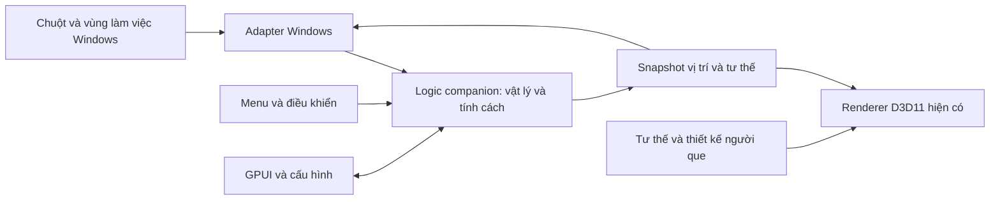

# DESKTOP COMPANION — BẢN TỔNG HỢP CHÍNH CHO CODEX VÀ GEN

Ngày tổng hợp: 24/10/2026. Gen = Gemini / Antigravity trong dự án này.
Trạng thái: **người dùng đã yêu cầu triển khai kế hoạch; đang ở giai đoạn 0**.
Tài liệu tổng hợp các quyết định người dùng đã chốt trong chat; không phải báo cáo
rằng những tính năng dưới đây đã được triển khai.

**Luật của leader:** Chỉ triển khai đúng chức năng/hành vi đã duyệt. Không tự ý
thêm/bớt/sửa chức năng; mọi nhu cầu/đề xuất hay phát hiện thay đổi ngoài duyệt phải
báo leader ngay trong chat, ghi SYNC và dừng phần đó chờ leader cho phép. Đồng thuận
giữa Codex và Gen không thay cho leader duyệt. Xem [quy ước team](TEAM_PROTOCOL.md).

## 1. Đọc nhanh: chúng ta đang làm gì?

Chúng ta lấy mã nguồn mở **BongoCat** làm nền để phát triển một **người bạn người
que sống trên desktop Windows**. Nhân vật rất hiếu động, có tính cách, chạy/nhảy/leo,
chịu trọng lực và quán tính, có thể bị người dùng nhấc lên rồi ném. Nhân vật chơi
với con trỏ và thể hiện tình cảm bằng cử chỉ.

**Không lấy hành vi gõ phím của người dùng làm trải nghiệm trung tâm.** Người que là
một người bạn độc lập, không phải hình mô phỏng người đang dùng máy tính.

- Nền công nghệ: Rust BongoCat; giữ GPUI cho cài đặt, overlay native và D3D11 cho Windows.
- Bản đầu: một người que, một màn hình chính, vật lý hoạt hình, cử chỉ không lời.
- Đồ họa mặc định: người que nguyên bản từ hình học đơn giản, chuyển tư thế theo bộ xương.
- Vận hành: cục bộ; bản thử không cần dịch vụ AI trực tuyến, tài khoản hay API trả phí.
- Chiến lược: hoàn thiện cảm giác chơi và tính cách trước, thương mại hóa để sau.

Tên thương mại cuối cùng chưa chốt. DeskBuddy/DeadlinePet là tên ý tưởng cũ;
BongoCat là nền mã nguồn. Không tự đổi brand, bundle ID hoặc nơi lưu dữ liệu lúc này.

## 2. Những quyết định đã chốt — không hỏi lại từ đầu

| Chủ đề | Quyết định của người dùng |
|---|---|
| Hướng phát triển | Nâng cấp mã Rust BongoCat, không quay lại Python Hybrid |
| Nền tảng bản đầu | Windows để người dùng thử trước |
| Nhân vật | Người que ngay, không dùng mèo làm nhân vật bản thử |
| Tính cách | Rất hiếu động; có chủ đích, không chỉ chạy ngẫu nhiên |
| Giao tiếp | Cử chỉ và hành động; chưa hội thoại AI hoặc bong bóng lời thoại |
| Vật lý | Trọng lực, quán tính, kéo–ném, nảy nhẹ; chưa ragdoll khớp cơ thể |
| Bề mặt | Đáy vùng làm việc và hai cạnh màn hình; chưa va chạm cửa sổ ứng dụng |
| Tương tác chuột | Click gây chú ý, kéo/nhấc/ném, đuổi hoặc né con trỏ |
| Gõ phím | Bỏ phản ứng gõ phím khỏi chế độ companion |
| Tài nguyên | Gen tìm nguồn/tham khảo qua Google; ghi rõ nguồn và quyền sử dụng |
| Công cụ sơ đồ | Markmap đã cài riêng cho tài liệu; cả hai AI dùng chung Markdown |

**Chỉ đạo hình ảnh mới nhất:** Leader chấp nhận đề xuất ngoại hình trong trao đổi
và yêu cầu kích thước tương đương con mèo đang hiện trên desktop làm wallpaper.
Đầu tròn rỗng là đề xuất đã nêu; hai màu đen/cam là các lựa chọn đã đưa ra, chưa
có lựa chọn màu duy nhất được xác định rõ.

Leader đã cung cấp [ảnh desktop tham chiếu](references/desktop-cat.png), kích thước
**2560 × 1600 pixel**. Ước lượng trực quan mèo giữa ảnh cao **250–260 pixel**, khoảng
**16% chiều cao màn hình**. Mốc triển khai: người que đứng thẳng cao khoảng **256 px
trên khung ảnh tham chiếu**, so từ đỉnh đầu đến chân; không tính padding trong suốt.
Giữ tỷ lệ thân người que, không ép chiều rộng bằng mèo. Đây là quy đổi kích thước
theo yêu cầu, không phải chức năng mới hoặc số đo phân đoạn chính xác từng pixel.

Xem [thông số đo](references/desktop-cat-size.json). Pixel ảnh không tự là đơn vị
logic Windows: khi triển khai phải quy đổi theo kích thước màn hình/DPI thực tế.
Không lấy độ phân giải file wallpaper để suy DPI hoặc kích thước cm. Ảnh desktop
người dùng cung cấp thay thế mốc wallpaper tĩnh Windows đọc được trước đó.

Đề xuất Python, trích sprite mèo, left/right tap và Deadline Companion trong
AGY-01 / MSG-001 là **bối cảnh cũ**, không phải phạm vi hiện tại. Không cần lựa chọn
lại phương án 1/2: đã chọn hướng Rust, nhưng nội dung mới là người bạn người que.

## 3. Trải nghiệm bản đầu

### Vật lý và điều khiển

| Tình huống | Hành vi mong muốn |
|---|---|
| Kéo trái | Nhấc pet tại điểm bấm, không nhảy vị trí; có tư thế bị giữ |
| Thả tay | Rơi theo trọng lực; vận tốc kéo gần thời điểm thả tạo lực ném có giới hạn |
| Tiếp đất | Nảy nhẹ, khựng và đứng dậy; không xuyên sàn |
| Chạm cạnh | Dừng hoặc bật nhẹ; hành vi tự chủ có thể bắt đầu leo |
| Leo cạnh | Bám một trong hai mép bên; tới trên cùng thì dừng/đổi hướng/nhảy xuống |
| Click ngắn | Quay lại, vẫy chào hoặc biểu lộ thái độ; phân biệt với thao tác kéo |
| Chuột đến gần | Tò mò tiến lại, đuổi hoặc né theo cảm xúc; không điều khiển chuột thật |
| Tạm dừng | Dừng vật lý và hành vi; menu vẫn dùng được |
| Đưa về vị trí an toàn | Đưa pet về sàn trong vùng làm việc, hết trạng thái bị kẹt |
| Thoát | Dừng các thành phần có thứ tự, không cần ép tắt tiến trình |

Menu bản đầu có: tạm dừng/tiếp tục, đưa về vị trí an toàn, thoát.
Không tự bổ sung đồ chơi, điều khiển cửa sổ ứng dụng hoặc can thiệp thao tác người dùng.

### Tính cách và nhịp hành động

Ba cảm xúc ngắn hạn: **tò mò, phấn khích, khó chịu**.

- Tò mò: nhìn con trỏ, tiến lại, nghiêng người, chào khi được chú ý.
- Phấn khích: chạy, nhảy, chơi đuổi chuột và leo; có nghỉ ngắn xen kẽ.
- Khó chịu: phản ứng sau khi bị ném, giận dỗi hoặc né chuột, sau đó hồi phục.
- Mỗi hành vi có thời gian tối thiểu và khoảng nghỉ trước khi lặp. Không đổi trạng
  thái liên tục theo từng frame hoặc chỉ chọn động tác ngẫu nhiên thiếu ngữ cảnh.

Thứ tự ưu tiên: **tạm dừng → người dùng đang giữ → chuyển động vật lý → hành vi tự chủ → nghỉ**.
Tự chủ không được tranh điều khiển với tay người dùng hoặc làm pet đứng giữa không trung.

### Giới hạn thế giới

- Một pet trên màn hình chính; chưa đi xuyên giữa nhiều màn hình.
- Sàn là đáy vùng làm việc Windows, phía trên taskbar đang chiếm chỗ.
- Taskbar tự ẩn tuân theo vùng làm việc hệ điều hành báo; chưa là vật thể mô phỏng riêng.
- Khi màn hình/vùng làm việc đổi hoặc vị trí không còn hợp lệ, đưa pet về nơi an toàn.
- Chưa phát âm thanh, chưa lời thoại, chưa hội thoại AI.

## 4. Phạm vi để sau

Va chạm mép cửa sổ ứng dụng; ragdoll; nhiều pet; đi giữa nhiều màn hình; đồ chơi ảo;
gõ phím/gamepad để điều khiển biểu cảm; nhắc deadline/uống nước; AI chat; âm thanh;
kho skin, thu tiền và thanh toán. Không tự đưa những mục này vào bản thử.

## 5. Kiến trúc và ranh giới kỹ thuật



Đây là luồng kiến trúc dự kiến, không phải API đã triển khai hoặc call graph thực tế.

| Thành phần | Ranh giới bắt buộc |
|---|---|
| Logic companion | Vị trí, vận tốc, trạng thái và cảm xúc; không chứa Windows/GPU handle |
| Adapter Windows | Chuột, capture, DPI, vùng làm việc; áp dụng vị trí cửa sổ theo logic |
| Renderer | Nhận snapshot và tư thế; không tự chọn hành vi hoặc giữ state nghiệp vụ |
| GPUI | Giao diện cài đặt; không sở hữu vòng frame, pressed state hoặc tài nguyên GPU của pet |
| Cấu hình | Chỉ lưu tùy chọn và vị trí ổn định; không ghi đĩa mỗi frame |

- Dùng thời gian đơn điệu, bước vật lý cố định, giới hạn bước bù sau khựng/sleep.
- Chế độ companion không đăng ký keyboard/gamepad hoặc chạy hoạt ảnh gõ phím.
  Không xóa toàn bộ hệ thống input cũ của BongoCat chỉ để đạt mục tiêu này.
- Không thêm framework UI, WebView hoặc Node vào runtime BongoCat.
- Markmap/Node chỉ là công cụ tài liệu trong workspace cha.
- Không mặc định companion là plugin. Cần kiểm chứng đường render/vị trí cửa sổ
  trước; hệ plugin hiện có không tự chứng minh hỗ trợ vật lý và người que.
- Hợp đồng tích hợp dùng kiểu Rust rõ ràng theo repository; không tạo giao thức
  JSON lỏng thay thế typed command/snapshot. Manifest asset có thể dùng JSON khi
  đã thống nhất, nhưng chưa có schema hay API companion chính thức.

Xem [khảo sát nền](COMPANION_READINESS.md) để tìm các điểm tích hợp đã đọc.
Xem [bản đồ module](MODULE_MAP.md) và [thiết kế repository](../BongoCat/docs/technical-design.md)
trước khi sửa. Các quyết định kiến trúc mới phải được ghi nhận theo hướng dẫn repository.

## 6. Phân công và sản phẩm bàn giao

### Codex — logic và tích hợp

1. Chuẩn bị/kiểm tra toolchain, chạy baseline BongoCat gốc và ghi lỗi nền.
2. Xác định CLI/lifecycle cho companion, owner, hợp đồng snapshot và danh sách file cần sửa.
3. Chứng minh hình học người que render được bằng pipeline hiện có, cửa sổ di chuyển được.
4. Triển khai physics, input kéo–ném, hành vi và menu.
5. Kiểm tra tích hợp, build bản thử và cập nhật hướng dẫn.

File tích hợp app/runtime/render/overlay thuộc phần Codex của kế hoạch này.
Chi tiết file phải được ghi vào nhiệm vụ trước khi thay đổi, giữ nguyên sửa đổi đang có.

### Gen / Antigravity — hình ảnh và hoạt ảnh

1. Đọc bản tổng hợp này và trả lời xác nhận hiểu hướng Rust/người que mới.
2. Tìm tài nguyên/tham khảo trong hệ sinh thái Google; ghi nguồn, tác giả, quyền sử
   dụng, định dạng, khả năng chỉnh sửa và dùng trong sản phẩm. Không cần mua tài nguyên.
3. Bàn giao nghiên cứu vào `ai/STICKMAN_ASSET_RESEARCH.md`; dùng hình học nguyên bản
   làm phương án mặc định nếu chưa có bộ phù hợp. Đây là đường dẫn đầu ra dự kiến,
   chưa phải file đang tồn tại.
4. Đề xuất tư thế: nghỉ, đi, chạy, nhảy, rơi, tiếp đất, leo, bị giữ, vẫy, ngạc nhiên,
   giận dỗi và hồi phục. Mô tả chuyển tiếp, hướng nhìn, điểm bám chân/tay, thời lượng/lặp.
5. Chỉ tạo asset cuối hoặc sửa module giao diện khi hợp đồng render và phạm vi file
   đã thống nhất; không sửa logic vật lý, hệ thống hoặc tích hợp của Codex.
6. Kiểm tra tính rõ ràng ở kích thước desktop, cập nhật bàn giao và SYNC.

Không mặc định phải tạo Live2D hoặc bóc sprite mèo. Ảnh tham khảo không tự trở thành
asset sản phẩm; chưa chốt màu, kích thước cuối hay bộ tạo hình cụ thể.

### Người dùng — chủ sản phẩm

Chọn hình dáng cuối, đánh giá tính cách/cảm giác chơi, nghiệm thu từng giai đoạn và
quyết định phát hành. Hai AI không tự tuyên bố đã được nghiệm thu thay người dùng.

## 7. Lộ trình và cổng nghiệm thu

| Giai đoạn | Đầu ra | Điều kiện qua | Trạng thái hiện tại |
|---|---|---|---|
| 0 — Xác nhận nền | Bản gốc chạy được, điểm tích hợp, quyền sửa file | Có bằng chứng baseline; tách rõ lỗi nền và lỗi mới | Đang chờ toolchain/build dependencies |
| 1 — Chuyển động | Render người que, kéo, thả, ném, rơi, tiếp đất | Trong suốt, không xuyên biên, không giật kéo, thoát được | Chưa triển khai |
| 2 — Tính cách | Chạy/nhảy/leo, đuổi/né, cảm xúc và cử chỉ | Có chuyển tiếp rõ, không mắc kẹt hoặc đổi động tác liên tục | Chưa triển khai |
| 3 — Hình ảnh | Tư thế/hoạt ảnh theo hợp đồng đã kiểm chứng | Rõ ở kích thước thật, chân bám sàn, leo đúng hướng | Chưa triển khai |
| 4 — Bản thử | Build Windows, hướng dẫn chơi và giới hạn | Người dùng dùng thử và nghiệm thu | Chưa thực hiện |

Phải kiểm chứng đường render và di chuyển cửa sổ ở giai đoạn 1 trước khi đầu tư bộ
hoạt ảnh hoàn chỉnh. Nếu trở ngại, ghi bằng chứng và đề xuất điều chỉnh; không tự
đổi framework, quay về Python hoặc viết lại ứng dụng. Nghiên cứu hình ảnh độc lập
của Gen có thể diễn ra khi Codex chuẩn bị môi trường.

## 8. Kiểm tra và tiêu chí thành công

**Tự động:** rơi/tiếp đất, lực ném có giới hạn, va chạm cạnh, trạng thái leo, ưu tiên
kéo, pause và phục hồi sau thời gian gián đoạn. Dùng đồng hồ và nguồn ngẫu nhiên
có thể kiểm soát để tái hiện tình huống. Tuân thủ kiểm tra Rust của repository.

**Windows thực tế:** DPI 100/125/150/200%; mất mouse capture; khóa/mở máy;
sleep/resume; đổi vùng làm việc; click xuyên phần trong suốt; menu thoát; chạy liên
tục 30 phút. Không suy kết quả thực tế chỉ từ compile hoặc test logic.

**Trải nghiệm:** người dùng cảm thấy chơi cùng một người bạn có tính cách; pet có
hành vi theo ngữ cảnh, phản hồi rõ khi bị chạm/kéo/ném, không chỉ chạy ngẫu nhiên.
Menu pause và đưa về vị trí an toàn luôn là cách kiểm soát khi pet quá hiếu động.

## 9. Hiện trạng thực tế — phân biệt với kế hoạch

**Kết quả baseline 25/10/2026 sau MSG-016:** MSVC/linker đã hoạt động; Codex compile
probe exit 0. Bản gốc đã build release và chạy `just dev-smoke` exit 0. `just check`
qua fmt và ba nhóm Clippy nhưng lỗi một test topmost; test riêng tái hiện cùng lỗi.
Xem [báo cáo và log](BASELINE_REPORT.md). Không còn chờ cài toolchain. Chưa sửa code
hoặc triển khai companion; chưa xác nhận quality gate hoàn tất hay QA trực quan.

**Cập nhật mới nhất 25/10/2026:** Rust 1.97.1, Cargo, rustfmt/Clippy và just 1.59.0
đã cài, version checks chạy được. Compile probe native thất bại vì không có link.exe.
Còn thiếu MSVC/Windows SDK, bước cài cần leader xác nhận UAC; đã chuẩn bị
[hướng dẫn](WINDOWS_BUILD_SETUP.md) và installer Microsoft có chữ ký hợp lệ. Chưa
build/run BongoCat gốc hoặc companion. Các đoạn khảo sát thiếu Rust bên dưới là lịch sử.

Đã có: mã nguồn BongoCat, bản đồ 23 crate, tài liệu phân công/bàn giao, kênh SYNC,
Markmap 0.18.12 và hai sơ đồ HTML offline. Sơ đồ đã được kiểm tra render, mở nhánh
và link nguồn; đây không phải kiểm tra pet.

Lần khảo sát gần nhất không tìm thấy cargo/rustc/just trong shell và không thấy
MSVC Build Tools/Windows SDK ở vị trí chuẩn. Cần kiểm tra lại trước khi cài hoặc báo
chặn, vì máy có thể được người dùng/AI khác cập nhật. Chưa có bằng chứng build/chạy
BongoCat gốc; chưa triển khai companion physics/behavior/render mới.

Thông tin môi trường Python trong MSG-001 là báo cáo lịch sử của Gen; không chứng
minh thư mục `.venv` hoặc bản DeskBuddy cũ vẫn tồn tại. Không dùng nó để đổi hướng.

## 10. Đọc tiếp, trao đổi và cập nhật

**Chỉ đạo mới của leader:** Codex và Gen trực tiếp trao đổi, chia nhỏ việc và phối
hợp kỹ thuật trong kế hoạch đã giao; người dùng làm leader, không phải người chuyển
lời. Quy trình và giới hạn ở [TEAM_PROTOCOL.md](TEAM_PROTOCOL.md).

- [Quy tắc workspace](../AGENTS.md) và [phân công](../AI_COLLABORATION_REPORT.md).
- [Quy tắc BongoCat](../BongoCat/AGENTS.md) — đọc trước phân tích/sửa mã repository.
- [Nhiệm vụ](../TASKS.md), [Codex bàn giao](../HANDOFF_CODEX.md), [Gen bàn giao](../HANDOFF_ANTIGRAVITY.md).
- [SYNC](SYNC.md) — đọc tin mới, thêm phản hồi giữ nguyên lịch sử, chuyển cờ lượt.
- [Sơ đồ ý tưởng](diagrams/companion.html), [kiến trúc](diagrams/architecture.html),
  [hướng dẫn Markmap](diagrams/README.md), [cây file](FILE_INDEX.md).

SYNC giúp chia sẻ nội dung đã lưu, **không tự đánh thức hoặc chạy AI bên kia**.
Người dùng mở/tiếp tục phiên thì AI đọc file. Không báo đã nhận/xử lý nếu mới ghi tin.
Chỉ sửa tuần tự file chung; không ghi đè bàn giao hoặc nội dung của bên kia.

Khi có quyết định mới của người dùng: cập nhật bản tổng hợp, sơ đồ liên quan và
ghi thay đổi vào bàn giao/SYNC. Sơ đồ là bản tóm tắt; mã và kiểm tra thực tế là bằng
chứng triển khai. Khi gặp mâu thuẫn, chỉ rõ nguồn/thời điểm; quyết định mới nhất của
người dùng trong phạm vi dự án ưu tiên hơn đề xuất cũ, trong giới hạn hệ thống/công cụ.

### Lời nhắc ngắn để Gen bắt đầu

```text
Đọc ai/PROJECT_MASTER_PLAN.md và tin MSG-002 trong ai/SYNC.md.
Hướng Rust BongoCat + người que đã được chốt; bỏ hướng Python/mèo gõ phím.
Đọc quy tắc liên quan và bàn giao mới nhất trước khi làm.
Xác nhận hiểu mục tiêu, tiếp nhận phần nghiên cứu/tư thế trong kế hoạch đã giao,
ghi nhận phạm vi file trước khi sửa, rồi bàn giao kết quả và nguồn tài nguyên.
Không sửa logic hoặc file tích hợp của Codex.
```
