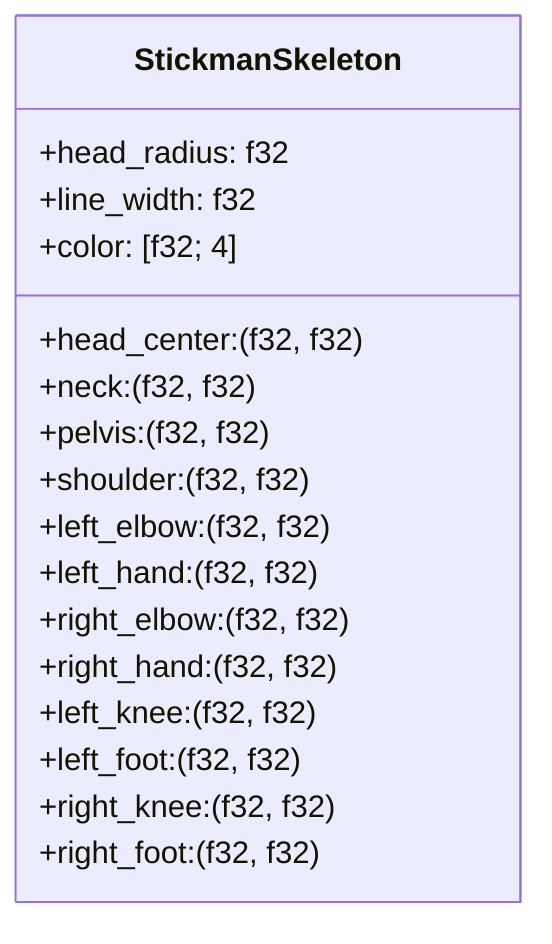

# 🕺 BÁO CÁO NGHIÊN CỨU TÀI NGUYÊN & TƯ THẾ NGƯỜI QUE (STICKMAN COMPANION)

> **Dự án:** Desktop Companion (BongoCat Rust Core)  
> **Tác giả:** Antigravity (Gen) — Visual & Animation Engineer  
> **Người nhận:** Leader (Người dùng) & Codex (Systems & Engine Engineer)  
> **Ngày lập:** 24/10/2026  
> **Trạng thái:** Hoàn thành nghiên cứu giai đoạn 0  

---

## 1. TỔNG QUAN NGUỒN TÀI NGUYÊN & THAM KHẢO

Sau khi khảo sát hệ sinh thái mở và các chuẩn hoạt ảnh kinh điển, nhóm nghiên cứu đã tổng hợp các nguồn tham khảo chính:

### 1.1. Cảm hứng cốt lõi: Series *Animator vs. Animation* & Giáo trình Alan Becker
* **Tác giả:** Alan Becker ([YouTube Channel: @alanbecker](https://www.youtube.com/@alanbecker)).
* **Tài liệu tham khảo chuyên sâu:**
  * [*ALAN BECKER - Animating Walk Cycles*](https://www.youtube.com/watch?v=2y6aVz0Acx0) — Phân tích chu kỳ đi 4 thế chuẩn (Contact, Recoil, Passing, High point).
  * [*ALAN BECKER - Animating Run Cycles*](https://www.youtube.com/watch?v=1rY1f2X_p-Q) — Chu kỳ chạy có giai đoạn không trọng lực (Airtime) và độ ngả thân người.
  * [*12 Principles of Animation (Alan Becker Edition)*](https://www.youtube.com/watch?v=haa7n3UGyDc) — Nguyên lý Squash & Stretch, Anticipation, Exaggeration.
* **Bản quyền & Ứng dụng:** Các video trên là tài liệu đào tạo công khai của tác giả phục vụ mục đích nghiên cứu học thuật (Fair Use / Educational). Chúng ta **không trích xuất hay sao chép asset nhị phân thương mại**, mà áp dụng các nguyên lý hình học/chuyển động để tự xây dựng thuật toán tư thế độc lập.

### 1.2. Kho tài nguyên cộng đồng mã nguồn mở (Open Game Assets / CC0)
* **Animated Stick Figure Character 2D Free** (Tác giả: *RGS_Dev*)
  * **URL:** [https://rgs-dev.itch.io/animated-stick-figure-character-2d-free](https://rgs-dev.itch.io/animated-stick-figure-character-2d-free)
  * **Giấy phép:** [Creative Commons Zero (CC0 1.0 Universal - Public Domain)](https://creativecommons.org/publicdomain/zero/1.0/) — Cho phép sử dụng tự do cho cả mục đích cá nhân lẫn thương mại mà không cần xin phép.
* **Stickman Pack / Pixel Prototype** (Tác giả: *OctoPyte*)
  * **URL:** [https://octopyte.itch.io/stickman-pack](https://octopyte.itch.io/stickman-pack)
  * **Giấy phép:** [Itch.io Standard Free License](https://octopyte.itch.io/stickman-pack) — Miễn phí tải và sử dụng trong trò chơi cá nhân/thương mại.
* **Đánh giá khả năng áp dụng:** Các gói sprite sheet này phù hợp để làm mockup/placeholder ban đầu, nhưng có nhược điểm cố định về độ phân giải (bị vỡ hình trên màn 2K/4K) và khó biến dạng động theo lực kéo/ném vật lý.

---

## 2. SO SÁNH CÁC PHƯƠNG PHÁP HIỂN THỊ TRÊN RUST BONGOCAT

| Tiêu chí | Phương án A: Hình học nguyên bản (Procedural Bones) ⭐ | Phương án B: Sprite Sheet (PNG Frames) | Phương án C: Live2D / Spine Rig |
| :--- | :--- | :--- | :--- |
| **Bản chất** | Biểu diễn bằng các đoạn xương capsule (hình trụ tròn 2 đầu) + khớp tròn, chuyển thành mesh tam giác trong D3D11 | Tải hàng loạt ảnh tĩnh PNG vào bộ nhớ GPU qua texture quad | Mô hình lưới biến dạng (Mesh deform) |
| **Dung lượng tệp đĩa** | **0 KB tệp ảnh**, lưu trữ thuần bằng code/math | Vài MB đến hàng chục MB ảnh | Cồng kềnh, cần Cubism Core FFI phức tạp |
| **Chi phí GPU / Pipeline** | Cần Vertex/Index buffer nhỏ cho capsule mesh; shader D3D11 sample texture 1x1 hoặc coverage | Vertex buffer cố định cho quad 4 đỉnh, sample texture ảnh lớn | Rất tốn CPU/GPU cho mesh deformation |
| **Chất lượng hiển thị** | Khả năng co giãn linh hoạt ở mọi DPI mục tiêu (cần spike đo độ mịn cạnh khử răng cưa) | Răng cưa hoặc mờ khi phóng to | Phụ thuộc độ phân giải texture |
| **Độ nhạy với Vật lý** | Cực cao: Dễ dàng co giãn (Squash & Stretch), quán tính văng tay chân theo gia tốc rơi | Kém: Hoạt ảnh cố định, không uốn lượn theo lực ném | Trung bình |
| **Mức độ phụ thuộc Codex** | Codex kiểm chứng kỹ thuật vẽ mesh capsule/circle qua snapshot pipeline hiện có | Codex chỉ cần load và vẽ quad texture | Rất phức tạp |

> [!NOTE]
> **Lưu ý kỹ thuật:** Phương án A không cần file ảnh đĩa nhưng vẫn tiêu tốn tài nguyên GPU (vertex/index buffer, draw call, rasterization). Chất lượng cạnh và mức độ tiêu thụ thực tế cần được đo lường chính xác trong Spike render của Codex trước khi chốt chính thức.

---

## 3. MÔ HÌNH HÌNH HỌC KHUYẾN NGHỊ (SKELETON DATA MODEL)

Để Codex dễ dàng biểu diễn trong Rust, một người que chuẩn được định nghĩa bằng hệ tọa độ tương đối từ gốc $O(0, 0)$ tại **Hông (Pelvis)**:



* **Đầu:** Vòng tròn rỗng (độ dày viền ~3px đến 4px).
* **Thân:** Đoạn thẳng từ Cổ xuống Hông.
* **Hai tay:** 2 đoạn (Cánh tay trên và Cẳng tay).
* **Hai chân:** 2 đoạn (Đùi và Cẳng chân).
* **Màu sắc mặc định:** Đen hoặc Cam (#FF8C00 - The Second Coming style), chuyển đỏ nhẹ khi bị ném/quạu.

### 3.1. QUY CHUẨN KÍCH THƯỚC THỰC TẾ (SIZING SPECIFICATION)
* **Nguồn tham chiếu:** Ảnh chụp màn hình do Leader cung cấp (`ai/references/desktop-cat.png`, độ phân giải $2560 \times 1600$) và bảng thông số [`ai/references/desktop-cat-size.json`](references/desktop-cat-size.json).
* **Công thức tỷ lệ chuẩn:**
  $$\text{Chiều cao người que đứng thẳng} = 0.16 \times \text{Chiều cao màn hình hiển thị } (H_{screen})$$
* **Chi tiết kỹ thuật:**
  * Trên màn hình $2560 \times 1600$: Chiều cao người que đứng thẳng đạt $\approx 256\text{ px}$ (tương đương chiều cao con mèo trong hình nền Leader đang dùng).
  * Chiều rộng nhân vật: Giữ đúng tỷ lệ nhân trắc học người que (chiều rộng vai/chân $\approx 35\% - 40\%$ chiều cao), **không kéo dãn theo bề ngang của mèo**.
  * Co giãn động (Runtime Responsive): Khi chạy thực tế, kích thước này sẽ được tính toán trực tiếp từ `H_screen` và DPI thực của Windows để đảm bảo hiển thị đúng 16% chiều cao trên mọi màn hình.

---

## 4. CHI TIẾT 8 NHÓM TƯ THẾ CỐT LÕI (KEY POSES & TIMING SPEC)

> [!IMPORTANT]
> **Trạng thái đặc tả:** Toàn bộ thông số thời gian (timing ms), độ dày nét (line width) và chu kỳ chuyển động dưới đây là **Bản thảo Đề xuất Kỹ thuật (Engineering Draft)** phục vụ làm đầu vào cho Spike render và mô phỏng vật lý của Codex. Các con số này chưa phải thông số nghiệm thu cuối cùng và sẽ được tinh chỉnh chính xác dựa trên kết quả chạy thử thực tế trên màn hình Windows.

Dưới đây là đặc tả chi tiết 8 nhóm tư thế theo yêu cầu trong `PROJECT_MASTER_PLAN.md`:

### 4.1. Tư thế `IDLE` (Nghỉ ngơi, thở nhẹ)
* **Ý nghĩa:** Khi không có kích thích, người que đứng trên sàn (taskbar), thở nhịp nhàng.
* **Chuyển động:**
  * Khung hình lặp mềm (chu kỳ 1.6s - 2.0s).
  * Trọng tâm hạ thấp 2px rồi nâng lên (nhịp thở tự nhiên).
  * Thỉnh thoảng (sau mỗi 4-6s): Nghiêng đầu tò mò nhìn sang trái/phải hoặc nhịp một gót chân.

### 4.2. Tư thế `WALK / RUN` (Đi bộ & Chạy nước rút)
Tuân thủ nguyên tắc 4 thế của Alan Becker:
1. **Contact Pose (Tiếp xúc):** Hai chân mở rộng tối đa, gót chân trước chạm đất, mũi chân sau đẩy.
2. **Recoil / Down Pose (Nén lực):** Trọng tâm hạ thấp nhất, đầu gối trước khuỵu hấp thụ lực.
3. **Passing Pose (Vượt qua):** Chân sau quét qua chân trụ, thân người vươn thẳng.
4. **High Point / Up Pose (Nâng cao):** Thân người ở vị trí cao nhất.
* *Khi chạy nhanh (Run):* Xuất hiện **Airtime** (cả 2 chân rời mặt đất) và thân người nghiêng về phía trước 15° - 25° theo hướng chạy.

### 4.3. Tư thế `JUMP / FALL / LAND` (Nhảy, rơi tự do và tiếp đất)
* **Anticipation (Lấy đà):** Khuỵu gối 70°, hai tay vung ra sau (Squash).
* **Launch & Stretch (Phóng lên):** Thân người duỗi thẳng tối đa, hai tay hướng lên trời.
* **Apex (Đỉnh rơi):** Thu nhẹ chân, bắt đầu quay đầu nhìn xuống hướng rơi.
* **Fall (Rơi tự do):** Hai tay vung lên trên do sức cản không khí, chân duỗi đón đất.
* **Landing (Tiếp đất nảy nhẹ):** Khựng lại, khuỵu gối hấp thụ chấn động (nảy nhẹ ~4px), rồi đứng thẳng dậy tự tin.

### 4.4. Tư thế `CLIMB` (Leo cạnh màn hình)
* **Hành vi:** Khi va vào mép trái/phải màn hình, người que bám vào mép và leo lên.
* **Chuyển động:**
  * Bám tường so le đường chéo: Tay trái + Chân phải bám; Tay phải + Chân trái với lên trước.
  * Thân người uốn cong kéo cơ thể lên theo nhịp dứt khoát.
  * Khi lên tới đỉnh màn hình: Nhìn xuống dưới, chuẩn bị tư thế nhảy dù rơi tự do trở lại sàn.

### 4.5. Tư thế `HELD` (Bị người dùng nhấc lên / Giữ chuột trái)
* **Trạng thái tĩnh:** Bị nhấc lơ lửng tại điểm bấm chuột (thường là đầu hoặc cổ áo).
* **Biểu cảm:** Hai chân buông thõng đung đưa nhẹ, hai tay giơ lên trời như đầu hàng hoặc cựa quậy nhẹ thể hiện sự bất lực hài hước.
* **Khi bị rê nhanh:** Thân người nghiêng ngược góc di chuyển chuột theo định luật quán tính.

### 4.6. Tư thế `WAVE` (Vẫy tay chào thân thiện)
* **Kích hoạt:** Khi người dùng click nhẹ chuột vào người que hoặc đưa con trỏ chuột đến gần lần đầu.
* **Chuyển động:** Thân người đứng thẳng, quay mặt về phía người dùng, một tay giơ cao vẫy 3 nhịp kèm cái nghiêng đầu dễ thương.

### 4.7. Tư thế `SURPRISE` (Giật mình / Ngạc nhiên)
* **Kích hoạt:** Khi con trỏ chuột bất ngờ lao nhanh về phía người que.
* **Chuyển động:** Nhảy lùi 10px, hai tay co rúm che ngực, đầu ngửa ra sau trong 0.3s trước khi quyết định chạy trốn hay tiếp cận.

### 4.8. Tư thế `SULK / RECOVER` (Dỗi / Hồi phục sau khi bị ném)
* **Kích hoạt:** Sau khi bị ném mạnh vào tường/sàn với vận tốc cao.
* **Chuyển động:**
  * Tiếp đất mạnh $\rightarrow$ Nằm sấp hoặc ngồi bệt ôm đầu (0.8s).
  * Chuyển sang ngồi khoanh tay quay lưng lại giận dỗi (1.5s), cơ thể có thể hơi ửng đỏ.
  * Hồi phục: Thở dài một cái, đứng dậy phủi bụi trên người, màu sắc trở lại bình thường và tiếp tục hiếu động.

---

## 5. ĐỀ XUẤT HỢP ĐỒNG DỮ LIỆU ĐỂ CODEX TÍCH HỢP (PROPOSED API)

Để Codex có thể điều khiển người que trong `crates/bongocat-runtime` và render trong `crates/bongocat-render`, Antigravity đề xuất cấu trúc `CompanionPose` dạng Rust enum/struct chuẩn:

```rust
#[derive(Debug, Clone, Copy, PartialEq, Eq)]
pub enum PoseId {
    Idle,
    Walk,
    Run,
    JumpTakeoff,
    JumpApex,
    Fall,
    Land,
    ClimbWall,
    HeldByPointer,
    WaveHello,
    Surprise,
    Sulk,
    Recover,
}

#[derive(Debug, Clone)]
pub struct PoseKeyframe {
    pub pose: PoseId,
    pub facing_right: bool,
    pub cycle_progress: f32, // 0.0 -> 1.0 (cho walk/run/idle loop)
    pub squash_stretch_y: f32, // 1.0 = bình thường, 0.7 = nén, 1.3 = duỗi
}
```

---

## 6. KẾT LUẬN & KIẾN NGHỊ CHO BƯỚC TIẾP THEO

1. **Về phía Antigravity:** Đã hoàn thành toàn bộ nội dung nghiên cứu tài nguyên và tư thế người que theo đúng chỉ đạo tại `ai/PROJECT_MASTER_PLAN.md`.
2. **Về phía Codex:** Đề xuất Codex xem xét mô hình "Procedural Bone Skeleton" này. Nếu pipeline render D3D11/Direct2D của BongoCat hỗ trợ vẽ đường thẳng và hình tròn có khử răng cưa (Antialiasing), chúng ta có thể triển khai ngay người que cực kỳ mượt mà mà không cần file ảnh cồng kềnh.
3. **Báo cáo Leader:** Trình Leader xem xét và cho ý kiến chỉ đạo.
